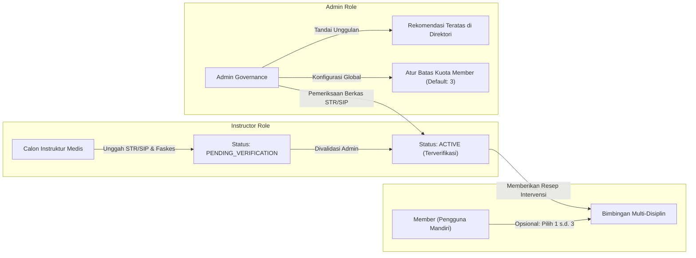
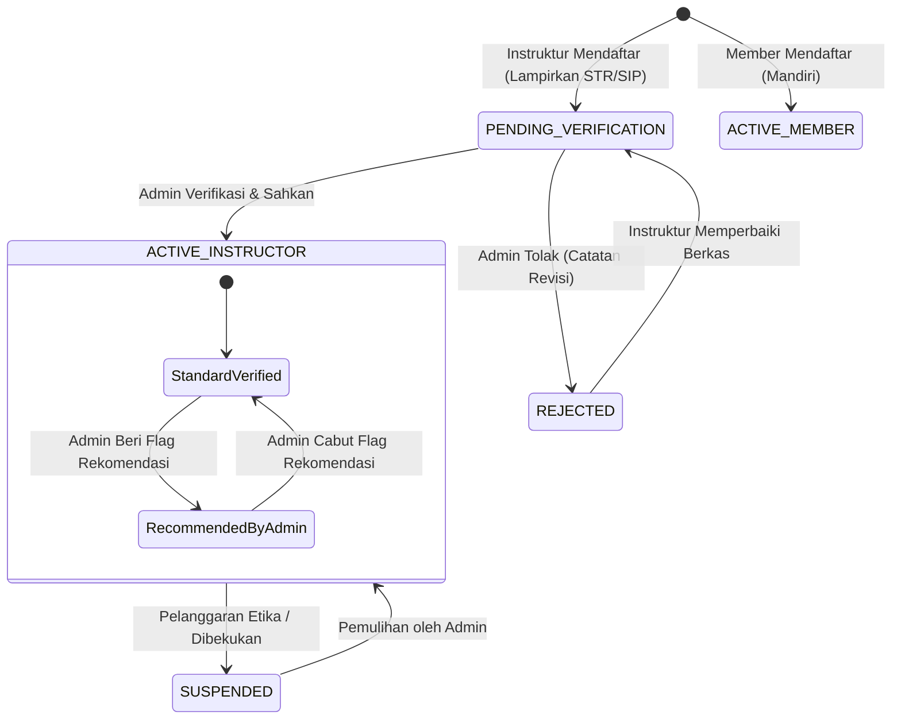

# Panduan Arsitektur 3 Role, Kuota Instruktur, & Alur Verifikasi Medis AEVYRA

Dokumen ini adalah referensi resmi mengenai arsitektur sistem multi-peran (*Multi-Role RBAC*), siklus verifikasi kredensial medis dokter/instruktur, serta aturan pembatasan kuota pendampingan member pada platform kesehatan preventif **AEVYRA**.

---

## 📑 Daftar Isi
1. [Ringkasan Tiga Peran Utama (Role Matrix)](#1-ringkasan-tiga-peran-utama)
2. [Aturan 1: Kuota & Kebebasan Pendampingan Member (Maksimal 3, Opsional)](#2-aturan-1-kuota--kebebasan-pendampingan-member)
3. [Aturan 2: Registrasi Instruktur & Pengunggahan Bukti Kredensial Medis](#3-aturan-2-registrasi-instruktur--kredensial-medis)
4. [Aturan 3: Meja Verifikasi Forensik & Rekomendasi Admin](#4-aturan-3-meja-verifikasi-forensik--rekomendasi-admin)
5. [Skema Basis Data & Relasi ERD](#5-skema-basis-data--relasi-erd)
6. [State Machine & Transisi Status Akun](#6-state-machine--transisi-status-akun)
7. [Daftar Endpoint & Aturan Validasi](#7-daftar-endpoint--aturan-validasi)
8. [Panduan Operasional Pengguna per Role](#8-panduan-operasional-pengguna-per-role)

---

## 1. Ringkasan Tiga Peran Utama



| Peran (*Role*) | Karakteristik Utama | Hak Akses Utama |
|---|---|---|
| **Member** | Pengguna aplikasi kesehatan yang memantau baseline biologis mandiri (glukosa, tekanan darah, tidur, aktivitas). Memiliki instruktur bersifat **opsional**. | Mengisi log kesehatan, konsultasi AI gaya hidup, melihat timeline, memilih 1 s.d. 3 instruktur terverifikasi, mengakhiri sesi bimbingan. |
| **Instruktur** | Tenaga medis profesional (Dokter Spesialis Gizi Klinis Sp.GK, Dokter Kedokteran Olahraga Sp.KO, Dokter Umum, Fisioterapis, Dietisien). | Mengakses caseload data fisiologis member binaan (*Human-in-the-loop*), meresepkan intervensi kebiasaan, mengadakan konsultasi telemedis preventif. |
| **Admin** | Tim tata kelola kepatuhan medis & audit platform. | Memverifikasi nomor STR/SIP dokter, mengesahkan/menolak berkas instruktur, mengatur kuota pendampingan member, memantau audit trail forensik. |

---

## 2. Aturan 1: Kuota & Kebebasan Pendampingan Member

### A. Sifat Kepemilikan Instruktur (Opsional)
- Member **tidak diwajibkan** memiliki instruktur untuk menggunakan fitur-fitur inti AEVYRA (pencatatan metrik, grafik tren sirkadian, asisten AI Gemini, kalkulator kalori, tombol SOS darurat 119).
- Pengguna yang ingin menggunakan aplikasi secara mandiri tetap mendapatkan rekomendasi otomatis dari *Health Behavior Engine (HBE)*.

### B. Kuota Maksimal Instruktur (Maksimal 3 Pendamping)
- Jika member menginginkan pendampingan profesional langsung dari tenaga medis, member dapat memilih **lebih dari 1 instruktur**, dengan batas maksimal **3 instruktur aktif** secara bersamaan.
- **Tujuan Multi-Instruktur**: Memungkinkan member memperoleh kolaborasi bimbingan lintas disiplin ilmu medis:
  - *Instruktur 1*: Dokter Spesialis Gizi Klinis (Sp.GK) untuk manajemen nutrisi & resistensi insulin.
  - *Instruktur 2*: Dokter Kedokteran Olahraga (Sp.KO) / Fisioterapis untuk program mobilitas fisik.
  - *Instruktur 3*: Psikolog Perilaku / Dietisien untuk pembentukan kepatuhan rutinitas tidur & stres.
- **Konfigurasi Dinamis**: Batas kuota 3 instruktur ini diatur oleh Admin melalui tabel `system_settings` (`max_instructors_per_member`), sehingga dapat disesuaikan tanpa perlu mengubah kode sumber.
- **Pelepasan Sukarela**: Member dapat melepaskan (*release*) salah satu instruktur kapan saja melalui antarmuka member untuk mengosongkan slot kuota dan memilih tenaga medis lain.

---

## 3. Aturan 2: Registrasi Instruktur & Kredensial Medis

### A. Persyaratan Data Wajib Saat Pendaftaran
Ketika seseorang mendaftar dengan memilih peran **Instruktur (Tenaga Medis)**, sistem mewajibkan pengisian data legalitas klinis berikut:
1. **Nama Lengkap beserta Gelar Akademik/Profesi** (contoh: *dr. Nabila Sarah, Sp.GK*).
2. **Bidang Spesialisasi / Profesi**:
   - Dokter Spesialis Gizi Klinis (Sp.GK)
   - Dokter Spesialis Kedokteran Olahraga (Sp.KO)
   - Dokter Spesialis Penyakit Dalam (Sp.PD)
   - Dokter Umum Terverifikasi
   - Fisioterapis Klinis Berlisensi
   - Dietisien / Registered Dietitian (RD)
   - Psikolog Kesehatan Perilaku
3. **Nomor STR (Surat Tanda Registrasi Dokter / Tenaga Medis)** resmi dari Konsil Kedokteran Indonesia (KKI) / Konsil Tenaga Kesehatan Indonesia (KTKI).
4. **Nomor SIP (Surat Izin Praktik)** dari Dinas Kesehatan / Faskes terkait.
5. **Institusi / Rumah Sakit / Klinik Praktik Utama**.
6. **Lama Pengalaman Praktik Klinis** (dalam tahun).
7. **Unggah Berkas Bukti STR / SIP / Ijazah Profesi** (format PDF, JPG, atau PNG maksimal 10MB).
8. **Bio & Pendekatan Klinis Preventif**.
9. **Pernyataan Keaslian Berkas & Etika Medis**.

### B. Status Awal Pendaftaran (`PENDING_VERIFICATION`)
- Setelah menyelesaikan registrasi, akun instruktur otomatis berstatus `PENDING_VERIFICATION` dengan `is_verified = false`.
- Instruktur **tidak dapat mengakses dasbor operasional member** sebelum disetujui.
- Jika instruktur mencoba membuka dasbor, middleware `EnsureInstructorIsVerified` akan mencegat (*intercept*) dan menampilkan halaman **Pending Verification** yang memuat ringkasan berkas yang diajukan beserta status peninjauan.

---

## 4. Aturan 3: Meja Verifikasi Forensik & Rekomendasi Admin

### A. Alur Verifikasi oleh Admin
1. Admin membuka menu **Verifikasi Instruktur** di `/admin/instructors`.
2. Admin melihat kartu statistik ringkasan (*Total Instruktur*, *Menunggu Verifikasi STR*, *Terverifikasi Aktif*, *Rekomendasi Unggulan*).
3. Admin meninjau berkas instruktur dengan menekan tombol **Detail**:
   - Memeriksa keabsahan nomor STR dan SIP pada database KKI/Kemenkes.
   - Membuka dan mengunduh berkas fisik STR/SIP/Ijazah yang diunggah.
   - Memeriksa institusi faskes tempat bertugas dan pengalaman praktik.
4. **Keputusan Admin**:
   - **Sahkan & Verifikasi**: Mengubah status akun menjadi `ACTIVE`, mencatat `is_verified = true`, mencatat timestamp verifikasi dan ID admin pengesah, serta mencatat ke dalam `audit_logs`.
   - **Tolak Verifikasi**: Mengubah status menjadi `REJECTED`, menyimpan catatan alasan penolakan (misal: *Nomor STR tidak terbaca pada lampiran*). Instruktur dapat melihat alasan ini saat login.
   - **Bekukan Akun (Suspend)**: Menonaktifkan akses akun jika terjadi pelanggaran disiplin/etika.

### B. Alur Rekomendasi Instruktur ke Member
- Admin dapat menandai instruktur terverifikasi yang memiliki performa dan rekam jejak terbaik sebagai **Rekomendasi Unggulan AEVYRA** (`is_recommended = true`).
- Pada direktori pencarian member (`/member/instructors`):
  - **Hanya instruktur yang terverifikasi resmi (`ACTIVE` + `is_verified = true`) yang ditampilkan**.
  - Instruktur berstatus *Rekomendasi Unggulan* akan selalu **diurutkan di posisi paling atas** dengan lencana emas (*Gold Star Badge*).
  - Member dapat melihat nomor STR resmi dan institusi faskes instruktur sebelum memutuskan memilih.

---

## 5. Skema Basis Data & Relasi ERD

```
+-----------------------------------------------------------------------------------+
|                                      USERS                                        |
+-----------------------------------------------------------------------------------+
| id (PK) | name | email | password | status [ACTIVE, PENDING_VERIFICATION, ...]   |
+-----------------------------------------------------------------------------------+
         | 1                                               | 1
         |                                                 |
         v 1                                               v 1
+------------------------------------+   +------------------------------------------+
|          MEMBER_PROFILES           |   |           INSTRUCTOR_PROFILES            |
+------------------------------------+   +------------------------------------------+
| id (PK)                            |   | id (PK)                                  |
| user_id (FK -> users.id)           |   | user_id (FK -> users.id, UNIQUE)         |
| display_name                       |   | str_number (Nomor STR Dokter)            |
| date_of_birth, sex, occupation     |   | sip_number (Nomor SIP Praktik)           |
| timezone, locale                   |   | specialization (Sp.GK, Sp.KO, dll.)      |
+------------------------------------+   | institution (RS / Klinik)                |
                                         | years_of_experience (Tahun)              |
                                         | document_proof_path (File Bukti STR)     |
                                         | bio (Pendekatan Klinis)                  |
                                         | is_verified (BOOLEAN, default: false)    |
                                         | verified_at (TIMESTAMP, nullable)        |
                                         | verified_by (FK -> users.id, nullable)   |
                                         | rejection_reason (TEXT, nullable)        |
                                         | is_recommended (BOOLEAN, default: false) |
                                         | max_member_capacity (INTEGER: 50)        |
                                         +------------------------------------------+

+-----------------------------------------------------------------------------------+
|                          INSTRUCTOR_MEMBER_ASSIGNMENTS                            |
+-----------------------------------------------------------------------------------+
| id (PK)                                                                           |
| member_id (FK -> users.id)       [Member yang dibimbing]                          |
| instructor_id (FK -> users.id)   [Instruktur/Dokter pengampu]                     |
| status [ACTIVE, ENDED, PAUSED]   [Status hubungan bimbingan]                      |
| starts_at (DATETIME)                                                              |
| ends_at (DATETIME, nullable)                                                      |
| assigned_by (FK -> users.id)     [User pembuat relasi]                            |
+-----------------------------------------------------------------------------------+

+-----------------------------------------------------------------------------------+
|                                 SYSTEM_SETTINGS                                   |
+-----------------------------------------------------------------------------------+
| id (PK) | key (UNIQUE)               | value | type    | description              |
| 1       | max_instructors_per_member | 3     | integer | Kuota maks instruktur/mbr|
+-----------------------------------------------------------------------------------+
```

---

## 6. State Machine & Transisi Status Akun



---

## 7. Daftar Endpoint & Aturan Validasi

### A. Autentikasi & Registrasi
- `POST /register`:
  - `role = 'member'`: Memvalidasi `name`, `email`, `password`, `consent`. Menghasilkan akun `ACTIVE` role Member.
  - `role = 'instructor'`: Memvalidasi `name`, `email`, `password`, `specialization`, `str_number`, `institution`, `years_of_experience`, `proof_document` (file upload max 10MB), `consent`. Menghasilkan akun `PENDING_VERIFICATION` role Instruktur.

### B. Member - Manajemen Tim Instruktur
- `GET /member/instructors`: Menampilkan direktori seluruh instruktur terverifikasi (disortir dengan rekomendasi di posisi teratas), daftar instruktur yang sedang aktif membimbing member, serta sisa kuota.
- `POST /member/instructors/{instructor}/assign`: Memilih instruktur.
  - **Validasi 1**: Instruktur harus berstatus `ACTIVE` dan `is_verified = true`.
  - **Validasi 2**: Member belum pernah memilih instruktur tersebut dengan status aktif.
  - **Validasi 3**: Total instruktur aktif member `< max_instructors_per_member` (maksimal 3). Jika sudah 3, sistem menolak dengan pesan error yang jelas.
- `POST /member/instructors/{instructor}/release`: Melepaskan sesi pendampingan secara sukarela, mengosongkan 1 slot kuota.

### C. Admin - Verifikasi & Rekomendasi
- `GET /admin/instructors`: Daftar seluruh calon & tenaga medis terdaftar beserta berkas kredensial.
- `POST /admin/instructors/{user}/approve`: Pengesahan verifikasi STR. Mengubah status ke `ACTIVE` dan `is_verified = true`.
- `POST /admin/instructors/{user}/reject`: Penolakan verifikasi dengan pencatatan alasan `reason`.
- `POST /admin/instructors/{user}/recommend`: Menghidupkan/mematikan status rekomendasi unggulan (`is_recommended`).
- `POST /admin/settings`: Memperbarui batas kuota `max_instructors_per_member` (1 s.d. 10).

---

## 8. Panduan Operasional Pengguna per Role

### Bagi Pengguna / Member
1. **Penggunaan Bebas Tanpa Instruktur**: Anda dapat langsung memantau data biologis harian, riwayat glukosa, pola tidur, dan menggunakan AI Lifestyle Chat secara mandiri.
2. **Memilih Tim Pendamping**: Masuk ke menu **Tim Pendamping** (`/member/instructors`), telusuri dokter spesialis atau dietisien yang direkomendasikan AEVYRA, lalu klik **Pilih Pendamping** (maksimal 3 pendamping).
3. **Mengganti Pendamping**: Jika ingin berkonsultasi dengan dokter lain saat kuota 3/3 penuh, cukup klik tombol **Lepas** pada salah satu profil pendamping aktif Anda.

### Bagi Tenaga Medis / Instruktur
1. **Pendaftaran**: Pilih tipe akun **Instruktur (Tenaga Medis)** pada halaman pendaftaran, lengkapi nomor STR resmi, SIP, nama rumah sakit/faskes tempat Anda bertugas, dan unggah foto/scan STR atau ijazah Anda.
2. **Masa Peninjauan**: Setelah mendaftar, akun Anda akan memasuki status *Dalam Peninjauan Admin*. Anda dapat melihat status dan catatan admin secara transparan saat login.
3. **Praktik & Bimbingan**: Setelah disahkan oleh Admin, dasbor operasional akan terbuka dan profil Anda akan otomatis tampil di direktori pencarian member.

### Bagi Administrator Platform
1. **Pemeriksaan STR/SIP**: Buka `/admin/instructors`, periksa permohonan berstatus *Menunggu Verifikasi (Pending)*, klik **Detail**, dan periksa nomor STR serta dokumen yang dilampirkan.
2. **Pengesahan / Penolakan**: Klik **Sahkan** untuk mengaktifkan dokter, atau **Tolak** dengan mengisi alasan penolakan jika berkas tidak sah atau buram.
3. **Pemberian Rekomendasi**: Untuk instruktur teladan dengan rating tinggi, klik **Rekomendasikan ke Member** agar profilnya dipromosikan di urutan teratas.
4. **Penyesuaian Kuota**: Masuk ke menu **Konfigurasi Sistem** (`/admin/settings`) untuk menyesuaikan batas maksimal kuota instruktur per member jika diperlukan.

