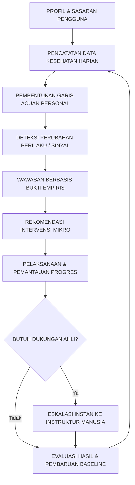

# PRONOIA — Project Context Rules

| Parameter Dokumen | Spesifikasi Teknis Konteks Proyek |
| :--- | :--- |
| **Kode Dokumen** | `PRONOIA-RULE-000` |
| **Klasifikasi Dokumen** | Kaidah Pokok Konteks Proyek & Rekayasa Arsitektur (*Project Context & Core Engineering Rules*) |
| **Versi Standar** | `v1.0.0-PROD` (Kaidah Acuan Standar Ekosistem PRONOIA) |
| **Target Ekosistem** | Laravel 11.x / 12.x Modular Monolith, PWA, Tailwind CSS, PostgreSQL 16, Google Gemini AI Gateway |
| **Kepatuhan Regulasi** | UU Perlindungan Data Pribadi (UU PDP No. 27/2022), Batasan Keselamatan Klinis, Standar ICONFEST 2026 |
| **Status Otoritas** | **KAIDAH WAJIB DAN MENGIKAT (MANDATORY SOVEREIGN RULES)** |

---

### Ringkasan Eksekutif (Executive Summary)

Dokumen ini mendefinisikan identitas fundamental, filosofi produk, batasan keselamatan klinis, hierarki domain arsitektur, dan kode etik rekayasa teknis untuk seluruh pengembang perangkat lunak dan agen AI yang berkontribusi dalam ekosistem PRONOIA. 

PRONOIA dirancang bukan sekadar sebagai aplikasi pencatat kesehatan atau *chatbot* kecerdasan buatan biasa, melainkan sebagai platform kesehatan preventif personal (*Personal Preventive Health & Early Intervention Platform*) yang menghubungkan data kebiasaan hidup longitudinal pengguna dengan deteksi perubahan pola berbasis garis acuan personal (*personal baseline*), menghasilkan wawasan wajar berbasis bukti ilmiah, memandu intervensi mikro terukur, serta menyediakan jalur eskalasi ke tenaga ahli manusia (*human-in-the-loop*). Seluruh modul, fitur, dan keputusan teknis yang diambil wajib mengabdi pada penguatan siklus lup kesehatan preventif tertutup ini.

```text
┌───────────────────────────────────────────────────────────────────────────┐
│               4 PILAR KONTEKS ARSITEKTUR PLATFORM PRONOIA                 │
├───────────────────────┬───────────────────────────────────────────────────┤
│ Pilar 1 (Sec 1 - 5)   │ Identitas, Filosofi Produk & Inovasi Lup Tertutup │
│ Pilar 2 (Sec 6 - 11)  │ Peran Pengguna, 5 Domain Sistem & Aliran Data Inti│
│ Pilar 3 (Sec 12 - 16) │ Keselamatan Klinis, Peran AI & Privasi UU PDP     │
│ Pilar 4 (Sec 17 - 27) │ Prioritas MVP, Disiplin Rekayasa & Kaidah Pamungkas│
└───────────────────────┴───────────────────────────────────────────────────┘
```

---

## 1. Identitas Proyek dan Platform (Project Identity)

PRONOIA adalah platform rekayasa perilaku kesehatan preventif dan intervensi dini berbasis web progresif (*Progressive Web App - PWA*). Platform ini dirancang untuk menghubungkan pengamatan data kebiasaan hidup longitudinal dengan panduan preventif yang dapat dijelaskan secara rasional serta pendampingan tenaga ahli manusia.

| Parameter Identitas | Nilai Spesifikasi Resmi |
| :--- | :--- |
| **Nama Proyek** | `PRONOIA` |
| **Nama Produk Lengkap** | **PRONOIA — Personal Preventive Health & Early Intervention Platform** |
| **Tipe Aplikasi** | *Progressive Web App* (PWA) — *Mobile-First, Installable, Offline-Resilient* |
| **Domain Utama** | Kesehatan Preventif (*Preventive Health*), Pemantauan Perilaku Hidup, Intervensi Mikro Terarah, dan Pendampingan Manusia (*Human Health Support*) |
| **Taksonomi Pengguna** | **Anggota (*Member*)**, **Instruktur Kesehatan (*Instructor*)**, **Administrator (*Admin*)** |
| **Penyelenggara & Target** | Kompetisi Rekayasa Perangkat Lunak ICONFEST 2026 / Standar Kesiapan Produksi Medis |

---

## 2. Tujuan Pokok Produk (Product Purpose)

PRONOIA hadir untuk mentransformasi paradigma kesehatan dari pendekatan reaktif (berobat saat sudah jatuh sakit) menjadi pendekatan **proaktif preventif** (menjaga kesehatan sebelum muncul gejala klinis).

### Kapabilitas Inti yang Disediakan bagi Pengguna:
1. **Memahami Informasi Kesehatan (*Health Literacy*)**: Menyajikan metrik fisiologis dan pola kebiasaan hidup dalam bahasa yang mudah dipahami tanpa kebingungan istilah medis rumit.
2. **Memantau Perilaku Harian (*Daily Behavior Monitoring*)**: Mencatat tidur, aktivitas fisik, hidrasi, dan nutrisi secara teratur dan ringan.
3. **Mengenali Pergeseran Bermakna (*Recognizing Meaningful Shifts*)**: Mendeteksi deviasi pola kebiasaan terhadap garis acuan personal (*personal baseline*) pengguna sendiri.
4. **Menerima Bimbingan Terjelaskan (*Explainable Guidance*)**: Menyajikan wawasan berbasis bukti data konkret, bukan tebakan algoritma kotak hitam (*black box*).
5. **Menjalankan Intervensi Mikro Terstruktur (*Structured Micro-Interventions*)**: Memandu pengguna mengadopsi kebiasaan sehat harian terencana selama 7 hingga 21 hari.
6. **Mengevaluasi Kemajuan Secara Terukur (*Measurable Outcome Tracking*)**: Membandingkan kondisi sebelum dan sesudah intervensi secara objektif.
7. **Mengakses Pendampingan Instruktur Manusia (*Human Instructor Support*)**: Menyediakan jalur eskalasi konsultasi ke instruktur kesehatan saat menghadapi dinamika kebiasaan yang kompleks.

> [!CAUTION]
> **Batasan Peran Produk**: PRONOIA dirancang secara tegas sebagai sistem pendukung gaya hidup sehat preventif. Platform ini **tidak bertujuan untuk mendiagnosis penyakit medis, meresepkan farmakoterapi, atau menggantikan peran dokter serta fasilitas pelayanan kesehatan resmi**.

---

## 3. Akar Permasalahan Utama (Core Product Problem)

Akar masalah mendasar dalam kesehatan preventif modern bukanlah ketiadaan alat pencatat (*health trackers*), melainkan ketidakmampuan pengguna dalam memahami arti perubahan pola data mereka dari waktu ke waktu (*longitudinal behavioral blindness*).

```text
[ Fenomena Masalah: Pembusukan Kebiasaan Bertahap (Insidious Behavioral Decay) ]

Minggu 1: Tidur 7.5 jam/malam ──> Kondisi Prima
Minggu 2: Tidur 6.8 jam/malam ──> Sedikit lelah, dianggap biasa
Minggu 3: Tidur 5.9 jam/malam ──> Asupan kopi manis melonjak, hidrasi air putih turun
Minggu 4: Tidur 5.2 jam/malam ──> Kelelahan kronis, imun anjlok, produktivitas runtuh
                                  (PENGGUNA TIDAK MENYADARI TREN AKUMULATIF INI)
```

### Karakteristik Masalah yang Diselesaikan:
- **Perubahan Berlangsung Samar (*Gradual Accumulation*)**: Kebiasaan buruk menumpuk secara perlahan sehingga tidak disadari hingga timbul gangguan fisik nyata.
- **Data Terfragmentasi (*Siloed Data*)**: Pengguna memiliki catatan langkah kaki di satu aplikasi dan jam tidur di aplikasi lain tanpa keterkaitan kausalitas.
- **Nasihat Terlalu Generik (*Generic Advice Fatigue*)**: Nasihat umum seperti "minum 8 gelas air" atau "tidur 8 jam" sering kali tidak realistis bagi ritme hidup individu tertentu.

PRONOIA menyelesaikan permasalahan ini dengan menjahit rekaman data kebiasaan longitudinal menjadi **satu alur kerja preventif yang tertutup, kontekstual, terjelaskan, dan dapat ditindaklanjuti secara nyata**.

---

## 4. Inovasi Pokok dan Diferensiasi (Core Innovation & Loop)

Diferensiasi dan inovasi utama PRONOIA **BUKAN TERLETAK** pada fitur individual yang berdiri sendiri secara terisolasi:
- Bukan sekadar *Chatbot AI* yang menjawab teks umum.
- Bukan sekadar *Food Scanner* pemindai kalori foto makanan.
- Bukan sekadar *Health Tracker* pencatat langkah harian.
- Bukan sekadar *Tantangan Komunitas* atau papan peringkat gamifikasi.

Nilai inovasi tertinggi PRONOIA adalah **konektivitas terpadu antarkomponen dalam satu siklus lup kesehatan preventif tertutup (*Closed-Loop Preventive Health Architecture*)**:

> **Personal Behavioral Baseline + Behavioral Change Detection + Explainable Intervention + Outcome Monitoring + Human Escalation**



Setiap fitur yang dirancang dan dibangun ke dalam repositori PRONOIA wajib memperkuat rantai siklus di atas, bukan menjadi pulau fitur terisolasi.

---

## 5. Filosofi Perancangan Produk (Product Philosophy)

Pengembangan platform PRONOIA berlandaskan pada 6 (enam) pilar filosofi rekayasa produk:

### 5.1 Pencegahan Melampaui Diagnosis (Prevention Over Diagnosis)
Fokus tertinggi sistem adalah pada kesadaran pola hidup, literasi kebiasaan, dan tindakan preventif dini sebelum penyakit bermanifestasi secara klinis. Sistem dilarang memposisikan dirinya sebagai mesin vonis penyakit medis.

### 5.2 Konteks Personal Melampaui Nasihat Generik (Personal Context Over Generic Advice)
Jika data historis yang memadai telah tersedia, setiap wawasan dan saran tindakan wajib mempertimbangkan pola hidup dasar personal pengguna (*individual historical baseline*), bukan sekadar menerapkan patokan rata-rata populasi umum yang kaku.

### 5.3 Keterjelasan Melampaui Kotak Hitam (Explainability Over Black Box)
Pengguna berhak memahami logika di balik setiap wawasan yang mereka terima melalui prinsip *5 Pertanyaan Keterjelasan*:
1. **Apa yang berubah?** (*What changed?*)
2. **Dibandingkan dengan apa?** (*Compared with what?*)
3. **Pada rentang waktu mana?** (*Over what time period?*)
4. **Mengapa sistem memperhatikan hal ini?** (*Why the system noticed it?*)
5. **Apa tindakan praktis berikutnya?** (*What can be done next?*)

### 5.4 Kolaborasi Pendampingan Manusiawi (Human-in-the-Loop)
Kecerdasan buatan (AI) bertindak sebagai asisten yang memberdayakan anggota dan instruktur, bukan sebagai pengganti pertimbangan profesional tenaga kesehatan manusia.

### 5.5 Privasi Sejak Awal Perancangan (Privacy by Design)
Data kesehatan adalah informasi pribadi yang sangat sensitif. Sistem hanya mengumpulkan data yang benar-benar esensial (*data minimization*), menyimpannya dengan enkripsi ketat, dan membatasi pembagian data hanya atas persetujuan sadar pengguna.

### 5.6 Intervensi yang Terukur dan Akuntabel (Measurable Intervention)
Setiap saran tindakan preventif harus dapat diubah menjadi rencana intervensi konkret yang kemajuan hariannya dapat dipantau dan hasil perbaikannya dapat dievaluasi secara objektif.

---

## 6. Taksonomi Peran Pengguna Utama (Core User Roles)

Ekosistem PRONOIA digerakkan oleh 3 (tiga) peran pengguna inti dengan batas tanggung jawab dan ruang lingkup otorisasi yang terdefinisi secara ketat:

### 1. Anggota (Member)
Anggota adalah pengguna akhir utama yang mengelola kesehatan diri secara mandiri.

```text
Hak & Kemampuan Utama:
├── Membuat dan memperbarui profil serta sasaran gaya hidup
├── Mencatat rekaman data kesehatan harian (tidur, hidrasi, aktivitas, glukosa, tekanan darah)
├── Menggunakan pemindai kamera (scanner) untuk mencatat nutrisi makanan
├── Meninjau linimasa riwayat kesehatan pribadi (timeline)
├── Menerima dan meninjau wawasan perubahan perilaku
├── Berinteraksi dengan asisten edukasi AI
├── Menjalankan tantangan dan intervensi kebiasaan sehat
├── Memantau grafik kemajuan intervensi harian
├── Memesan jadwal sesi konsultasi dengan instruktur
├── Mengelola kendali privasi dan persetujuan pembagian data
└── Mengakses pintasan tombol tanggap darurat medis (SOS)
```
> **Aturan Otorisasi**: Anggota hanya memiliki akses ke data kesehatan pribadi miliknya sendiri. Akses terhadap rekaman anggota lain diblokir mutlak (*strict tenant isolation*).

---

### 2. Instruktur Kesehatan (Instructor)
Instruktur adalah tenaga profesional manusia yang memberikan bimbingan, verifikasi rencana, dan dukungan edukasi kesehatan terpersonalisasi.

```text
Hak & Kemampuan Utama:
├── Mengakses ruang kerja (dashboard) anggota binaan yang ditugaskan secara resmi
├── Meninjau ringkasan garis acuan dan sinyal deviasi perilaku anggota binaan
├── Memantau kepatuhan intervensi dan catatan perkembangan harian
├── Berkomunikasi secara privat melalui ruang konsultasi terbimbing
├── Menyelenggarakan sesi konsultasi telemedisin terjadwal
├── Merancang dan mengusulkan rencana intervensi tindak lanjut
└── Mengevaluasi hasil akhir intervensi bersama anggota
```
> **Aturan Otorisasi**: Instruktur **tidak memiliki akses otomatis ke seluruh anggota**. Akses informasi medis anggota hanya terbuka jika terdapat relasi penugasan aktif (*active assignment contract*) yang disetujui bersama.

---

### 3. Administrator Sistem (Admin)
Administrator bertanggung jawab atas stabilitas operasional, integritas platform, moderasi komunitas, dan kepatuhan sistem.

```text
Hak & Kemampuan Utama:
├── Mengelola akun pengguna dan verifikasi kredensial instruktur resmi
├── Mengelola master katalog artikel edukasi dan templat intervensi
├── Memoderasi ruang diskusi komunitas publik
├── Mengatur konfigurasi parameter operasional sistem
├── Meninjau analitik agregat teranonimkan untuk evaluasi performa platform
└── Menginspeksi jejak audit keamanan (*audit trail*) untuk kepatuhan regulasi
```
> **Aturan Otorisasi**: Hak administratif beroperasi di bawah prinsip hak akses terendah (*Least Privilege*). Status Admin **tidak memberikan izin mengintip data medis privat pengguna** tanpa tiket otorisasi investigasi resmi (*break-glass audit procedure*).

---

## 7. Domain Arsitektur Produk Primer (Primary Product Domains)

Arsitektur sistem PRONOIA diorganisasikan ke dalam 5 (lima) domain kapabilitas produk yang saling berinteraksi secara harmonis:

```text
┌───────────────────────────────────────────────────────────────────────────┐
│                      5 DOMAIN ARSITEKTUR PRODUK PRONOIA                   │
├──────────────────────────┬──────────────────────────┬─────────────────────┤
│ 1. Health Data           │ 2. Behavioral Intel.     │ 3. Intervention     │
│ (Data Mentah & Linimasa) │ (Baseline & Sinyal Tren) │ (Rencana Aksi Mikro)│
├──────────────────────────┼──────────────────────────┴─────────────────────┤
│ 4. Human Support         │ 5. Engagement (Supporting Only)                │
│ (Instruktur & Konsultasi)│ (Poin, Lencana, Membership, Forum Komunitas)   │
└──────────────────────────┴────────────────────────────────────────────────┘
```

| Domain Produk | Tanggung Jawab Arsitektur Utama |
| :--- | :--- |
| **Health Data** | Profil Pengguna, Metrik Fisiologis, Catatan Nutrisi, Ekstraksi Scanner, Linimasa Terpadu (*Timeline*). |
| **Behavioral Intelligence** | Kalkulasi Garis Acuan (*Baseline*), Deteksi Sinyal Perilaku, Skor Kebiasaan Sehat, Wawasan Terjelaskan. |
| **Intervention** | Mesin Rekomendasi Terarah, Rencana Intervensi 7–21 Hari, Tantangan Sehat (*Challenges*), Pemantauan Progres. |
| **Human Support** | Portal Kerja Instruktur, Jadwal & Reservasi Konsultasi, Catatan Pendampingan, Protokol Eskalasi Manusia. |
| **Engagement** | Buku Besar Poin (*Points Ledger*), Lencana Prestasi, Hak Keanggotaan (*Membership*), Komunitas Sehat. |

> [!IMPORTANT]
> **Kaidah Hierarki Domain**: Domain *Engagement* (gamifikasi, poin, langganan) adalah **fitur pendukung** yang berfungsi memperkuat konsistensi kebiasaan. Domain ini dilarang mendominasi atau mengubah kebenaran data pada domain inti kesehatan (*Health Data & Behavioral Intelligence*).

---

## 8. Alur Aliran Data Inti (Core Data Flow)

Aliran data dalam ekosistem PRONOIA dirancang secara terstruktur dan searah (*unidirectional conceptual pipeline*) dengan ketertelusuran penuh dari awal hingga akhir:

```text
[ Input Pengguna (Manual / Scanner / Sensor) ]
                      │
                      ▼
[ Validasi Skema & Batas Kewajaran Fisiologis ]
                      │
                      ▼
[ Persistensi Basis Data Terenkripsi (Audit Logging) ]
                      │
                      ▼
[ Penyajian Linimasa Kesehatan Kronologis (Timeline) ]
                      │
                      ▼
[ Agregasi Data & Kalkulasi Garis Acuan (Baseline) ]
                      │
                      ▼
[ Deteksi Deviasi Bermakna (Behavioral Signal) ]
                      │
                      ▼
[ Pembentukan Narasi Wawasan Berbasis Bukti (Insight) ]
                      │
                      ▼
[ Pemilihan Rekomendasi Intervensi Mikro Terarah ]
                      │
                      ▼
[ Pelaksanaan & Pemantauan Kemajuan Harian (Progress) ]
                      │
                      ▼
[ Evaluasi Hasil Komparatif Objektif (Outcome) ]
```

### Jaminan Ketertelusuran Data (*Data Traceability*):
Setiap wawasan dan rekomendasi yang tampil pada antarmuka anggota harus dapat ditelusuri kembali:
- Titik data historis spesifik mana yang memicu kalkulasi ini?
- Periode observasi kalender mana yang dianalisis oleh sistem?
- Aturan inferensi mana yang melahirkan sinyal tersebut?
- Bukti ilmiah apa yang melandasi pemilihan intervensi yang disajikan?

---

## 9. Prinsip Garis Acuan Perilaku Personal (Behavioral Baseline Principle)

Garis acuan personal (*Personal Behavioral Baseline*) adalah fondasi analitik PRONOIA yang merepresentasikan pola kebiasaan mapan milik pengguna itu sendiri, bukan nilai rata-rata orang lain.

```text
Contoh Nyata:
Garis Acuan Tidur Personal Budi : Rata-rata 7.2 jam/malam (Standar Deviasi: 0.4 jam)
Pengamatan 7 Hari Terakhir       : Rata-rata 5.4 jam/malam

Respon PRONOIA:
"Durasi tidur Anda minggu ini tercatat 1.8 jam lebih singkat dari garis acuan kebiasaan biasa Anda."
```

### Invarian Arsitektur Garis Acuan:
```text
┌───────────────────────────────────────────────────────────────────────────┐
│                       INVARIAN PERBEDAAN KLINIS                           │
│                                                                           │
│        PERSONAL BEHAVIORAL BASELINE  ≠  CLINICAL REFERENCE RANGE          │
│       (Pola Kebiasaan Individu)        (Standar Normal Medis Umum)        │
└───────────────────────────────────────────────────────────────────────────┘
```

Sistem dilarang menyamakan garis acuan personal dengan rentang rujukan laboratorium medis. Garis acuan personal adalah instrumen kesadaran diri (*self-awareness tool*), bukan kriteria diagnostik penyakit.

---

## 10. Prinsip Sinyal Perubahan Perilaku (Behavioral Signal Principle)

Sinyal Perilaku (*Behavioral Signal*) adalah observasi komputasional tingkat aplikasi yang menangkap deviasi pola kebiasaan terukur dalam rentang waktu tertentu.

### Karakteristik Sinyal Perilaku yang Sah:
- **Dapat Diobservasi (*Observable*)**: Berakar pada titik data riil (misal: penurunan konsistensi waktu tidur, lonjakan konsumsi minuman manis, atau penurunan frekuensi hidrasi harian).
- **Dapat Diterangkan (*Explainable*)**: Memiliki referensi rekaman bukti konkret yang dapat dilihat dan diverifikasi mandiri oleh pengguna.
- **Dapat Diuji (*Testable*)**: Aturan pemicu sinyal bersifat deterministik dan diverifikasi oleh rangkaian pengujian otomatis (*unit & feature tests*).

> [!WARNING]
> Sinyal perilaku **BUKAN vonis diagnosis klinis, BUKAN prediksi penyakit fatal, dan BUKAN penilaian medis definitif**. Sinyal berfungsi sebagai kompas awal untuk memandu tindakan preventif mandiri.

---

## 11. Prinsip Rencana Intervensi Terarah (Intervention Principle)

Intervensi kesehatan pada PRONOIA berfokus pada pembentukan kebiasaan mikro terencana (*micro-habits*) yang realistis dan dapat diukur tingkat kepatuhannya.

### 5 Kriteria Intervensi Berkualitas:
1. **Praktis & Dapat Diterapkan Segera (*Actionable & Feasible*)**: Saran tindakan dapat dilakukan oleh pengguna awam dalam rutinitas harian (misal: jalan kaki 15 menit atau relaksasi pernapasan 5 menit).
2. **Berorientasi Tindakan Mikro (*Micro-Interventions*)**: Menghindari target perubahan drastis yang memicu keputusasaan (*burnout*).
3. **Terikat Rentang Waktu Jelas (*Time-Bounded*)**: Memiliki durasi komitmen terukur (umumnya 7 hingga 21 hari kalender).
4. **Dapat Dipantau Harian (*Observable Progress*)**: Pengguna dapat menandai *check-in* harian dan melihat akumulasi konsistensi kebiasaan.
5. **Ketat dalam Ruang Lingkup Preventif**: Menolak saran intervensi yang mewajibkan konsumsi obat kimia keras, diet kelaparan ekstrem, atau prosedur medis invasif.

---

## 12. Posisi dan Peran AI dalam Ekosistem (AI Position in the Product)

Model kecerdasan buatan (*Artificial Intelligence*) pada PRONOIA diposisikan secara terukur sebagai **fasilitator literasi dan pemahaman**, bukan sebagai pembuat keputusan klinis otonom.

### Peran yang Diberikan kepada AI:
- Menerangkan wawasan data kesehatan yang telah terstruktur secara ramah dan mudah dipahami.
- Menjawab pertanyaan seputar edukasi gaya hidup preventif berbasis bukti ilmiah.
- Merangkum catatan perkembangan kebiasaan untuk ditinjau oleh pengguna atau instruktur pendamping.
- Memberikan dorongan motivasi empatis tanpa nada menghakimi (*supportive tone*).

### Batasan Larangan Keras AI (*Zero-Tolerance AI Restrictions*):
- AI dilarang menjadi penentu tunggal triase kegawatdaruratan medis.
- AI dilarang mendiagnosis penyakit secara mandiri.
- AI dilarang meresepkan merek obat medis atau mengubah dosis terapi dokter.
- AI dilarang mengeksekusi tindakan akun destruktif tanpa konfirmasi interaktif manusia (*Human-in-the-Loop Confirmation*).

---

## 13. Prinsip Eskalasi Terstruktur ke Manusia (Human Escalation Principle)

Ketika dinamika kesehatan atau pola perilaku pengguna menunjukkan kompleksitas di luar batasan aman aplikasi, sistem secara proaktif menyediakan alur eskalasi ke instruktur kesehatan manusia (*Human-in-the-Loop Escalation*).

```text
[ Deteksi Sinyal Perilaku Kompleks / Deviasi Berkelanjutan ]
                             │
                             ▼
[ Pengguna Menjalankan Intervensi Mandiri (7 Hari) ]
                             │
                             ▼
[ Evaluasi Kemajuan Menunjukkan Hasil Belum Optimal ]
                             │
                             ├── Pengguna Meminta Bantuan Ahli
                             │                  ATAU
                             └── Kriteria Ambang Batas Eskalasi Terpenuhi
                                                │
                                                ▼
           [ Pembuatan Tiket Konsultasi dengan Instruktur Manusia ]
                                                │
                                                ▼
           [ Sesi Konsultasi Telemedisin & Arahan Klinis Terbimbing ]
```

> [!NOTE]
> **Prinsip Fundamental Produk**: Eskalasi ke instruktur manusia adalah **kapabilitas utama produk (*product capability*) yang bernilai tinggi**, BUKAN cerminan kegagalan sistem kecerdasan buatan (*not an AI failure*).

---

## 14. Batasan Keselamatan Klinis Mutlak (Health Safety Boundary)

PRONOIA menegakkan batas keselamatan klinis mutlak (*Health Safety Boundary*) yang tidak dapat dikompromikan oleh fitur atau eksperimen apa pun.

### 8 Larangan Mutlak Sistem (*System Prohibitions*):
1. Dilarang menetapkan diagnosis penyakit formal bagi pengguna.
2. Dilarang meresepkan obat kimia keras atau sediaan farmakologis resep.
3. Dilarang memodifikasi atau menyarankan pengubahan dosis obat dokter.
4. Dilarang menginstruksikan pengguna untuk menghentikan pengobatan resmi yang sedang berjalan.
5. Dilarang menjanjikan kesembuhan ajaib (*miracle cure*) atau garansi 100% bebas penyakit.
6. Dilarang menggantikan kewenangan konsultasi dokter dan tenaga medis bersertifikasi.
7. Dilarang menunda atau menghambat proses evakuasi kegawatdaruratan medis.
8. Dilarang mengarang atau memalsukan data fisiologis kesehatan (*zero hallucination*).

### Standar Diksi Bahasa Keselamatan (*Mitigating Clinical Copy*):
Seluruh teks naratif wawasan, asisten AI, dan rekomendasi wajib menggunakan gaya bahasa kehati-hatian:
- *"Data rekaman Anda menunjukkan kecenderungan..."*
- *"Berdasarkan data yang Anda catat seminggu terakhir..."*
- *"Pola ini berbeda dari garis acuan kebiasaan biasa Anda..."*
- *"Sangat dianjurkan untuk mendiskusikan temuan ini dengan dokter atau tenaga medis profesional Anda."*

---

## 15. Prinsip Perlindungan Privasi Data Kesehatan (Privacy Principle)

Data kesehatan adalah informasi pribadi berkategori spesifik yang wajib dilindungi dengan standar privasi tertinggi sesuai Undang-Undang Perlindungan Data Pribadi (UU PDP No. 27/2022) dan praktik rekayasa *Privacy by Design*.

```text
[ Pengumpulan Data Minimal Esensial (Data Minimization) ]
                           │
                           ▼
[ Enkripsi Data Saat Istirahat & Transit (AES-256 / TLS 1.3) ]
                           │
                           ▼
[ Penggunaan Terbatas Hanya untuk Layanan Preventif ]
                           │
                           ▼
[ Pembagian Terkontrol Hanya Atas Persetujuan Sadar Pengguna ]
                           │
                           ▼
[ Sensor Data Sensitif dari Berkas Log Server (Redacted Logs) ]
                           │
                           ▼
[ Penghapusan Bersih & Hak untuk Dilupakan (Right to Erasure) ]
```

> [!CAUTION]
> **Larangan Pengumpulan Data Spekulatif**: Pengembang dilarang mengumpulkan atau meminta data fisiologis pengguna hanya dengan alasan "mungkin akan berguna di masa depan". Setiap kolom data kesehatan yang dikumpulkan wajib memiliki justifikasi fungsional preventif yang jelas.

---

## 16. Prinsip Penanganan Kegawatdaruratan Medis (Emergency Principle)

Jalur tanggap darurat medis (*Emergency Flow*) adalah rantai keselamatan dengan toleransi kegagalan nol (*zero-tolerance safety-critical path*). Alur ini harus bersifat **langsung, deterministik, dan terisolasi total dari ketergantungan model AI eksternal**.

```text
[ Pengguna Menekan Tombol Darurat Medis (SOS) ]
                       │
                       ▼
[ Tampilan Seketika (< 100 ms) Panduan Darurat Jelas ]
                       │
                       ▼
[ Akses Langsung Panggilan Bantuan Resmi: ]
├── Tombol Panggil Ambulans Nasional (119)
├── Tombol Panggil Layanan Darurat Umum (112)
└── Tombol Hubungi Kontak Darurat Keluarga (ICE Contact)
                       │
                       ▼
[ Rekomendasi Titik Fasilitas Gawat Darurat (IGD) Terdekat (Opsional GPS) ]
```

### Larangan Mutlak pada Alur Darurat:
- Dilarang mewajibkan pengguna mengisi kuesioner gejala bertahap sebelum tombol panggilan bantuan muncul.
- Dilarang menunggu hasil inferensi model bahasa AI (*LLM generation*) atau antrean background job.
- Dilarang memblokir akses tombol darurat karena sesi autentikasi kedaluwarsa atau kendala kuota langganan.

---

## 17. Matriks Prioritas Rilis MVP (MVP Priority Classification)

Pengembangan produk Minimum Viable Product (MVP) PRONOIA wajib berfokus pada diferensiasi inti platform dan mematuhi taksonomi prioritas fitur:

| Tingkat Prioritas | Cakupan Modul Fitur | Status Kesiapan Rilis |
| :--- | :--- | :--- |
| **P0 — Core (Fondasi Wajib)** | Autentikasi & Otorisasi RBAC, Profil Anggota, Pencatatan Metrik Harian, Linimasa Terpadu, Kalkulasi Baseline Personal, Mesin Sinyal Perilaku, Wawasan Terjelaskan, Rencana Intervensi Mikro, Pemantauan Progres Harian, Jalur Darurat Medis Deterministik. | **Wajib Lulus 100%** sebelum aplikasi didemonstrasikan ke juri. |
| **P1 — Important (Diferensiasi Utama)** | Pemindai Nutrisi Kamera (Scanner Vision), Asisten Edukasi AI Terpandu, Katalog Tantangan Kebiasaan, Portal Kerja Instruktur, Alur Pemesanan Konsultasi Telemedisin. | Diselesaikan segera setelah seluruh modul P0 berstatus stabil. |
| **P2 — Supporting (Pendukung Keterlibatan)** | Buku Besar Poin (*Points Ledger*), Lencana Pencapaian (*Badges*), Manajemen Hak Keanggotaan (*Membership*), Forum Komunitas Sehat, Laporan Ekspor PDF Lanjutan. | Fitur pendukung retensi; dilarang menghambat penyelesaian P0 dan P1. |
| **P3 — Future (Peta Jalan Masa Depan)** | Sinkronisasi Perangkat Sandang Otomatis (*Wearables: Apple Health / Google Fit*), Integrasi Alat Medis IoT (Glukometer Bluetooth), Integrasi Ekosistem Klinis Nasional (SatuSehat). | Dijadwalkan untuk fase pasca-kompetisi (Fase 8). |

> [!IMPORTANT]
> **Disiplin Rekayasa**: Tim pengembang dilarang memprioritaskan fitur pemanis P2/P3 (seperti animasi lencana atau forum sosial) jika fungsionalitas inti P0 (seperti ketelitian baseline dan alur intervensi) belum teruji secara tuntas.

---

## 18. Pengendalian Ruang Lingkup Fitur (Scope Control & Discipline)

PRONOIA secara sadar menolak menjadi aplikasi sapu jagat generik yang mencoba melakukan segalanya namun kehilangan kedalaman (*no bloated generic health app*).

### 6 Pertanyaan Penyaring Ruang Lingkup (*Scope Filters*):
Sebelum mengusulkan atau menambahkan fitur baru ke dalam repositori, tim wajib menjawab:
1. **Masalah nyata apa yang dihadapi pengguna yang diselesaikan oleh fitur ini?**
2. **Peran pengguna mana (*Member, Instructor, Admin*) yang benar-benar membutuhkannya?**
3. **Apakah fitur ini secara langsung memperkuat siklus lup kesehatan preventif tertutup?**
4. **Data pribadi baru apa yang harus dikumpulkan dan apakah data tersebut esensial?**
5. **Apa konsekuensi keselamatan klinis, beban kognitif antarmuka, dan risiko privasinya?**
6. **Bisakah fitur ini ditunda ke fase rilis berikutnya tanpa mengorbankan nilai produk?**

Jika suatu fitur tidak memperkuat pemahaman data atau kepatuhan intervensi pengguna, fitur tersebut wajib dieliminasi atau ditunda.

---

## 19. Konteks dan Narasi Panggung Kompetisi (Competition Context & Narrative)

Dalam konteks evaluasi panggung kompetisi (ICONFEST 2026), PRONOIA dinilai berdasarkan ketepatan solusi masalah, kedalaman rekayasa teknis (*technical depth*), kebaruan inovasi arsitektur, dan dampak nyata bagi manusia.

### Pembeda Narasi Kompetisi:
```text
Narasi Pasif & Dangkal (Klise):
"Kami membuat aplikasi kesehatan yang menggunakan teknologi canggih Artificial Intelligence."

Narasi Otoritatif PRONOIA (Pemenang Kompetisi):
"PRONOIA menghubungkan data kebiasaan hidup longitudinal pengguna dengan deteksi 
perubahan pola berbasis garis acuan personal, menghasilkan wawasan preventif yang dapat 
dijelaskan secara ilmiah, serta menggerakkan intervensi terukur yang didampingi oleh tenaga ahli manusia."
```

Seluruh implementasi antarmuka, API backend, dan dataset benih demo panggung (*demo seeders*) harus dirancang agar narasi keunggulan di atas dapat dibuktikan secara langsung di hadapan dewan juri dalam waktu 3 menit.

---

## 20. Fondasi dan Tumpukan Teknologi (Technology Stack Baseline)

Kecuali diputuskan secara eksplisit melalui pembaruan arsitektur formal, fondasi tumpukan teknologi PRONOIA distandarisasi pada teknologi modern yang matang dan berkinerja tinggi:

- **Backend Framework**: Laravel 11.x / 12.x (Arsitektur *Modular Monolith*, Form Requests, Policy-based Authorization, Event Listeners).
- **Bahasa Pemrograman**: PHP 8.4+ (Enforced Type Safety, Constructor Property Promotion, Attributes, Readonly Properties).
- **Basis Data Utama**: PostgreSQL 16+ / MySQL 8+ (ACID Transactions, Foreign Key Constraints, Generated Columns, JSONB).
- **Styling & Antarmuka**: Tailwind CSS v3.4+ & Desain Token Kanonikal (Teal, Slate, Indigo).
- **Bundler & Build Tool**: Vite (Hot Module Replacement, Code Splitting, Tree-Shaking).
- **Distribusi Klien**: Progressive Web App (PWA) (Service Worker Caching, Web Manifest, Offline-First App Shell).
- **Kecerdasan Buatan**: Integrasi Server-Side AI Gateway (Google Gemini API via aman di backend tanpa kebocoran API Key ke klien).

> [!NOTE]
> Arsitektur mengutamakan **Monolit Modular (*Modular Monolith*)** yang teruji, bersih, dan mudah diaudit daripada memecah sistem secara prematur ke dalam *microservices* yang rumit.

---

## 21. Konteks Struktur Repositori (Repository Structure Context)

Struktur direktori repositori PRONOIA mencerminkan pemisahan tanggung jawab (*Separation of Concerns*) yang jelas antara kode aplikasi, aturan agen AI, dan dokumentasi rekayasa:

```text
kadar/ (Root Repositori)
│
├── AGENTS.md                 <-- Instruksi orkestrasi global agen AI ruang kerja
├── README.md                 <-- Gambaran umum proyek dan panduan instalasi
│
├── .agents/                  <-- Konfigurasi otonom agen & aturan privat
│   ├── agents/               <-- Definisi persona agen terspesialisasi
│   └── rules/                <-- Aturan pembatas perilaku rekayasa lokal
│
├── docs/                     <-- Dokumentasi rekayasa sistem lengkap
│   ├── docs/                 <-- Spesifikasi teknis domain 00 s.d. 15
│   └── rules/                <-- Kaidah arsitektur sistem (00-project-context.md, dst.)
│
├── app/                      <-- Logika bisnis domain backend Laravel
│   ├── Domain/               <-- Logika inti (HealthBehaviorEngine, Baseline, Signals)
│   ├── Http/                 <-- Controllers, Middleware, Form Requests, Resources
│   ├── Models/               <-- Entitas Eloquent dan relasi basis data
│   └── Services/             <-- Layanan orkestrasi (AI, Scanner, Consultation)
│
├── database/                 <-- Migrasi skema, seeders kompetisi, dan model factories
├── public/                   <-- Berkas web publik, aset statis manifes PWA, dan ikon
├── resources/                <-- Antarmuka Blade, komponen frontend, berkas CSS & JS
├── routes/                   <-- Definisi rute API terproteksi dan rute web
└── tests/                    <-- Rangkaian pengujian otomatis (Unit, Feature, Architecture)
```

> [!CAUTION]
> **Larangan Struktur Duplikat**: Dilarang membuat folder `.agents` di dalam direktori `docs/` atau menyalin aturan duplikat secara berantakan. Seluruh aturan rekayasa dipusatkan pada direktori resminya masing-masing.

---

## 22. Hierarki dan Otoritas Dokumentasi (Documentation Hierarchy)

Pengambilan keputusan rekayasa pada PRONOIA mengikuti hierarki otoritas dokumentasi yang berjenjang:

```text
[ AGENTS.md (Kaidah Utama Perilaku Agen) ]
                    │
                    ▼
[ .agents/rules/ (Aturan Spesifik Ruang Kerja) ]
                    │
                    ▼
[ docs/ (Spesifikasi Domain & Kontrak Arsitektur) ]
                    │
                    ▼
[ Implementasi Kode Sumber & Rangkaian Pengujian Otomatis ]
```

### Bukti Empiris Kode Sumber (*Code as Empirical Evidence*):
Meskipun dokumentasi menjadi pedoman desain, kode sumber yang berjalan dan lulus pengujian otomatis adalah representasi fakta perilaku sistem saat ini. Sebelum mengubah arsitektur:
1. Inspeksi kode sumber implementasi yang aktif.
2. Pelajari dokumen spesifikasi terkait di `docs/`.
3. Jalankan pengujian otomatis untuk memverifikasi perilaku aktual.
4. Identifikasi ketidaksesuaian (*discrepancies*).
5. Ajukan solusi penyempurnaan secara terukur dan terencana.

---

## 23. Konsistensi Arsitektur Modular (Architecture Consistency)

Setiap fitur baru yang diperkenalkan wajib terintegrasi secara harmonis dengan rantai siklus arsitektur inti PRONOIA:

```text
[ Anggota (Member) ]
         │
         ▼
[ Profil & Sasaran Pribadi ]
         │
         ▼
[ Rekam Data Kesehatan Harian ]
         │
         ▼
[ Mesin Perilaku (Behavior Engine) ]
         │
         ▼
[ Wawasan Berbasis Bukti (Insights) ]
         │
         ▼
[ Rekomendasi Intervensi Mikro ]
         │
         ▼
[ Pelacakan Progres & Evaluasi Hasil ]
         │
         ▼
[ Dukungan Pendampingan Instruktur ]
```

### Penyelarasan Modul Pendukung:
Modul-modul berikut dirancang sebagai **pendukung alur utama**, bukan sistem independen yang terisolasi:
- **Scanner Citra Nutrisi**: Mempermudah pencatatan data ke domain *Health Data*.
- **Asisten Edukasi AI**: Menjelaskan temuan pada tahap *Insights* dan menjawab keraguan intervensi.
- **Tantangan & Gamifikasi**: Membangun motivasi konsistensi pada tahap *Intervention*.
- **Langganan Keanggotaan**: Membuka kuota komputasi lanjutan dan sesi *Instructor Support*.
- **Notifikasi Terjadwal**: Menjaga momentum pelaksanaan kebiasaan harian.

---

## 24. Kode Etik dan Perilaku Agen AI (Agent Behavior & Engineering Ethics)

Setiap agen AI (termasuk Antigravity dan kontributor otomatis) yang bekerja pada repositori PRONOIA wajib mematuhi standar etika rekayasa perangkat lunak profesional:

### Kode Etik Agen Rekayasa:
- **Inspeksi Sebelum Eksekusi**: Selalu periksa kode sumber, dependensi, dan dokumen arsitektur sebelum membuat perubahan.
- **Patuhi Konvensi yang Ada**: Pertahankan gaya penulisan, pola penamaan, dan standar format yang telah disepakati tim.
- **Hindari Refaktorisasi Liar**: Jangan merombak struktur kode yang stabil hanya demi preferensi gaya pribadi tanpa kebutuhan fungsional nyata.
- **Tegakkan Keamanan & Privasi**: Selalu periksa otorisasi peran, pencegahan BOLA/IDOR, dan kepatuhan UU PDP pada setiap endpoint baru.
- **Uji Aturan Kritis**: Tulis pengujian otomatis (*unit/feature tests*) untuk setiap logika matematika, kalkulasi baseline, dan mesin aturan.
- **Kejujuran Intelektual Mutlak**: Dilarang mengarang informasi (*no hallucination*) atau mengklaim suatu pengujian telah lulus jika verifikasi belum benar-benar dieksekusi di lingkungan kerja.

---

## 25. Prinsip Pengambilan Keputusan Teknis (Decision-Making Principle)

Ketika pengembang atau agen dihadapkan pada beberapa pilihan arsitektur yang secara teknis sama-sama valid, keputusan akhir wajib memprioritaskan opsi yang memberikan nilai keunggulan tertinggi:

```text
┌───────────────────────────────────────────────────────────────────────────┐
│              8 PRIORITAS PENGAMBILAN KEPUTUSAN TEKNIS PRONOIA             │
├───────────────────────────────────────────────────────────────────────────┤
│ 1. Batas domain bisnis lebih tegas dan terisolasi rapi                    │
│ 2. Kemampuan pengujian otomatis lebih tinggi dan deterministik            │
│ 3. Risiko keamanan siber dan kebocoran otorisasi lebih rendah             │
│ 4. Risiko keselamatan klinis dan salah tafsir medis lebih kecil           │
│ 5. Tingkat eksposur privasi data pribadi lebih minimal                    │
│ 6. Kemudahan pemeliharaan kode jangka panjang (Maintainability)           │
│ 7. Kesederhanaan implementasi (Menolak kompleksitas yang tidak perlu)     │
│ 8. Keselarasan paling kuat dengan siklus lup kesehatan preventif PRONOIA  │
└───────────────────────────────────────────────────────────────────────────┘
```

> [!TIP]
> **Kaidah Kesederhanaan**: Jangan pernah memilih arsitektur rumit hanya agar terlihat canggih. Pilihlah solusi yang paling sederhana, kokoh, mudah diuji, dan aman bagi pengguna.

---

## 26. Kriteria Fitur Berkualitas Tinggi (Definition of a Good PRONOIA Feature)

Sebuah fitur dianggap bermutu tinggi dan layak diimplementasikan ke dalam ekosistem PRONOIA jika dan hanya jika perancang fitur dapat menjawab 8 pertanyaan kunci berikut dengan jelas:

```text
[ 1. Siapa yang membutuhkannya? (Who needs it?) ]
                       │
                       ▼
[ 2. Masalah spesifik apa yang diselesaikannya? (What problem does it solve?) ]
                       │
                       ▼
[ 3. Data kesehatan apa yang digunakannya? (What data does it use?) ]
                       │
                       ▼
[ 4. Apa kalkulasi atau inferensi yang dilakukan sistem? (What is calculated?) ]
                       │
                       ▼
[ 5. Apa yang dilihat pengguna secara visual? (What does the user see?) ]
                       │
                       ▼
[ 6. Tindakan konkret apa yang dapat diambil pengguna? (What action is taken?) ]
                       │
                       ▼
[ 7. Bagaimana kemajuan dan hasil perbaikan diukur? (How is progress measured?) ]
                       │
                       ▼
[ 8. Kapan dukungan instruktur manusia menjadi relevan? (When to escalate?) ]
```

Jika salah satu dari 8 pertanyaan di atas tidak dapat dijawab secara logis dan transparan, fitur tersebut wajib dikembalikan ke meja perancangan konsep sebelum sebaris kode pun ditulis.

---

## 27. Kaidah Pamungkas Ekosistem PRONOIA (Final Project Sovereign Rule)

Kaidah tertinggi yang mengikat seluruh pengembang, perancang antarmuka, analis mutu, dan agen AI dalam proyek PRONOIA adalah:

> **PRONOIA harus selalu dirasakan oleh pengguna sebagai SATU KESATUAN SISTEM KESEHATAN PREVENTIF YANG KOHEREN, bukan sekadar tumpukan fitur kesehatan acak yang ditempel bersamaan.**

Bintang panduan arsitektur (*Architectural North Star*) yang menjadi jiwa dari platform ini adalah siklus lup pencegahan terpadu:

```text
[ 1. OBSERVE      ] ──> Mengamati rekaman kebiasaan hidup harian
        │
        ▼
[ 2. UNDERSTAND   ] ──> Memahami garis acuan kebiasaan personal pengguna
        │
        ▼
[ 3. DETECT SHIFT ] ──> Menangkap deviasi atau pergeseran pola yang bermakna
        │
        ▼
[ 4. EXPLAIN      ] ──> Menerangkan bukti data pendukung secara transparan
        │
        ▼
[ 5. INTERVENE    ] ──> Memandu tindakan intervensi mikro berbasis bukti
        │
        ▼
[ 6. MONITOR      ] ──> Memantau konsistensi kemajuan komitmen harian
        │
        ▼
[ 7. ESCALATE     ] ──> Menghubungkan ke instruktur manusia saat diperlukan
        │
        ▼
[ 8. IMPROVE      ] ──> Mencapai perbaikan derajat kesehatan dan kualitas hidup
```

Setiap baris kode, setiap migrasi skema basis data, setiap kontrak API, dan setiap piksel antarmuka yang dibangun wajib mengabdi pada perwujudan siklus mulia di atas.
