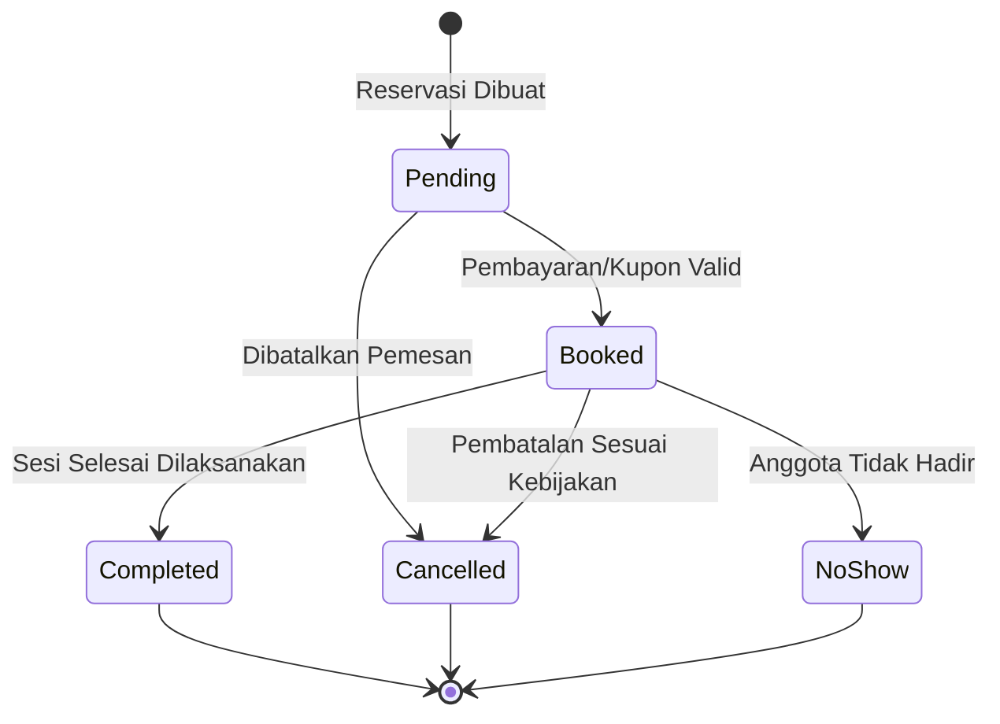

# AEVYRA — Architecture Rules

| Parameter Dokumen | Spesifikasi Teknis Kaidah Arsitektur |
| :--- | :--- |
| **Kode Dokumen** | `AEVYRA-RULE-001` |
| **Klasifikasi Dokumen** | Kaidah Pokok Rekayasa Arsitektur Perangkat Lunak (*Core Software Architecture & Engineering Rules*) |
| **Versi Standar** | `v1.0.0-PROD` (Kaidah Acuan Standar Produksi & Panggung Kompetisi ICONFEST 2026) |
| **Gaya Arsitektur** | **Monolit Modular (*Modular Monolith*)** — *Domain-Driven, Thin Controllers, Single-Action Classes* |
| **Fondasi Ekosistem** | Laravel 11.x / 12.x, PHP 8.4+, PostgreSQL 16+, Redis, Vite, Tailwind CSS, Progressive Web App (PWA) |
| **Kepatuhan Kualitas** | Standar Kualitas ISO/IEC 25010, UU PDP No. 27/2022, OWASP API Top 10, WCAG 2.1 Level AA |
| **Status Otoritas** | **KAIDAH ARSITEKTUR WAJIB DAN MENGIKAT (MANDATORY ARCHITECTURE RULES)** |

---

### Ringkasan Eksekutif (Executive Summary)

Dokumen ini mendefinisikan standar arsitektur perangkat lunak resmi yang menjadi fondasi bagi seluruh rekayasa sistem di dalam repositori AEVYRA. Sistem dirancang mengadopsi gaya **Monolit Modular (*Modular Monolith*)** guna memberikan keseimbangan optimal antara isolasi batas domain bisnis yang bersih, kemudahan pengujian otomatis deterministik, serta kesederhanaan operasional rilis produksi tanpa beban kerumitan *microservices* prematur.

Dalam arsitektur AEVYRA, logika bisnis kesehatan dipisahkan secara tegas dari lapisan transportasi HTTP. Basis data PostgreSQL bertindak sebagai satu-satunya sumber kebenaran otoritatif (*Single System of Record*), sedangkan kecerdasan buatan (AI) diposisikan sebagai layanan eksternal pendukung yang terpagar di balik antarmuka adapter (*Interface Adapter Pattern*). Seluruh keputusan teknis, rancangan skema basis data, dan kontrak API wajib menjaga kelancaran dan integritas siklus lup kesehatan preventif tertutup: **Observe ──► Detect ──► Explain ──► Intervene ──► Monitor ──► Escalate ──► Improve**.

```text
┌───────────────────────────────────────────────────────────────────────────┐
│              6 KLASTER KAIDAH ARSITEKTUR SISTEM AEVYRA                   │
├───────────────────────┬───────────────────────────────────────────────────┤
│ Klaster 1 (Sec 1 - 7) │ Fondasi Arsitektur, Tumpukan Laravel & Lapisan    │
│ Klaster 2 (Sec 8 - 15)│ Batas Domain, Mesin Perilaku & Integrasi AI       │
│ Klaster 3 (Sec 16 - 25)│ Pemrosesan Asinkron, Basis Data & Konkurensi      │
│ Klaster 4 (Sec 26 - 33)│ Arsitektur API, DTO, Caching & Otorisasi Berlapis │
│ Klaster 5 (Sec 34 - 41)│ Arsitektur Frontend, Berkas, Audit Trail & PWA    │
│ Klaster 6 (Sec 42 - 60)│ Tata Kelola Kode, Anti-Pola & Prinsip Pamungkas   │
└───────────────────────┴───────────────────────────────────────────────────┘
```

---

## 1. Tujuan Standar Arsitektur (Purpose & Scope)

Dokumen ini mendefinisikan standar arsitektur perangkat lunak resmi (*architectural standards*) yang wajib dipatuhi dalam seluruh siklus perancangan, pengembangan, dan pemeliharaan platform AEVYRA.

Arsitektur sistem AEVYRA dirancang untuk memenuhi pilar keunggulan teknis:
- **Kemudahan Pemeliharaan (*Maintainability*)**: Batas domain yang bersih dan modularitas tinggi untuk kemudahan evolusi kode.
- **Keterujian Deterministik (*Testability*)**: Logika bisnis domain yang terisolasi dari lapisan transportasi HTTP dan dependensi luar.
- **Keamanan Siber Berlapis (*Security-in-Depth*)**: Penegakan otorisasi peran, validasi masukan ketat, dan perlindungan aset digital.
- **Kedaulatan Privasi Data (*Privacy by Design*)**: Kepatuhan terhadap UU Perlindungan Data Pribadi (UU PDP No. 27/2022).
- **Ketertelusuran Aliran Data (*Predictable Data Flow*)**: Alur data searah (*unidirectional pipeline*) yang transparan dan dapat diaudit.
- **Kecerdasan Perilaku Terjelaskan (*Explainable Behavioral Intelligence*)**: Algoritma garis acuan dan sinyal berbasis bukti empiris nyata.
- **Kolaborasi Manusia-dan-AI (*Human-in-the-Loop*)**: Kemitraan harmonis antara asisten cerdas dan instruktur kesehatan manusia.
- **Ekstensibilitas Masa Depan (*Future Extensibility*)**: Kesiapan integrasi perangkat medis sandang tanpa merombak arsitektur inti.

> [!IMPORTANT]
> Arsitektur AEVYRA wajib dipahami secara jernih oleh pengembang perangkat lunak manusia maupun agen rekayasa kecerdasan buatan (*AI coding agents*). Kerapian struktur kode dan kepatuhan konvensi adalah syarat mutlak kelayakan produksi.

---

## 2. Gaya Arsitektur Monolit Modular (Architectural Style - Modular Monolith)

AEVYRA menetapkan gaya arsitektur **Monolit Modular (*Modular Monolith*)** sebagai standar baku pengembangan platform. Pendekatan ini menggabungkan kesederhanaan operasional monolit dengan kerapian isolasi batas domain khas arsitektur modular modern.

```text
┌───────────────────────────────────────────────────────────────────────────┐
│              ARSITEKTUR MONOLIT MODULAR APLIKASI AEVYRA                  │
├───────────────────────────────────────────────────────────────────────────┤
│                                                                           │
│  [ HTTP / API Gateway Layer ] ──> [ Controllers, Form Requests, Policies ] │
│                                                │                          │
│                                                ▼                          │
│  [ Application Services & Actions ] ──> [ Orchestration & Workflows ]     │
│                                                │                          │
│                                                ▼                          │
│  [ Domain Logic Layer ] ──> [ HealthBehaviorEngine, Baseline, Signals ]   │
│                                                │                          │
│                                                ▼                          │
│  [ Persistence & Events Layer ] ──> [ Eloquent, DB Transactions, Queues ] │
│                                                                           │
└───────────────────────────────────────────────────────────────────────────┘
```

### Penolakan Arsitektur Prematur (*Avoid Premature Microservices*):
Tim pengembang dilarang memecah sistem ke dalam arsitektur *microservices* terdistribusi (seperti *AI Microservice*, *Scanner Microservice*, *Notification Service*) tanpa adanya justifikasi beban operasional atau kebutuhan bisnis nyata yang terdokumentasi.

| Keunggulan Monolit Modular AEVYRA | Bahaya Microservices Prematur |
| :--- | :--- |
| **Transaksi Atomik ACID Mudah**: Integritas data kesehatan terjamin dalam satu transaksi basis data. | **Distribusi Transaksi Rentan**: Butuh *saga pattern* rumit yang rawan kegagalan konsistensi data. |
| **Pengujian Otomatis Cepat**: Seluruh rangkaian tes berjalan dalam milidetik di memori tanpa mock jaringan. | **Overhead Pengujian Tinggi**: Butuh mock HTTP masif dan orkestrasi kontainer rumit. |
| **Deployment Sederhana**: Rilis satu artefak utuh yang deterministik dan mudah dipulihkan saat darurat. | **Beban Operasional Berat**: Manajemen Kubernetes, *service mesh*, latensi jaringan, dan *distributed tracing*. |

---

## 3. Laravel sebagai Fondasi Inti Aplikasi (Laravel as Application Core)

Kerangka kerja Laravel (versi 11.x / 12.x) adalah fondasi utama aplikasi. Pengembang wajib mengoptimalkan kapabilitas bawaan (*native capabilities*) ekosistem Laravel secara maksimal sebelum memperkenalkan abstraksi kustom:

- **Routing & Middleware**: Penanganan titik masuk HTTP dan gerbang otorisasi.
- **Controllers & Form Requests**: Orkestrasi permintaan masukan dan validasi skema.
- **Policies & Gates**: Otorisasi akses berbasis peran (*Role-Based*) dan berbasis kepemilikan (*Ownership-Based*).
- **Eloquent ORM**: Pemetaan objek relasional, relasi kultural, casting, dan query scope.
- **Database Migrations & Seeders**: Manajemen evolusi skema dan inisialisasi dataset demo kanonikal.
- **Queues & Jobs**: Pemrosesan asinkron untuk tugas berat (ekstraksi citra, kalkulasi baseline, notifikasi).
- **Events & Listeners**: Pemisahan tanggung jawab antarmodul berbasis peristiwa bisnis.
- **Cache & Redis**: Akses cepat data referensi non-sensitif dan penguncian atomik (*atomic locks*).
- **API Resources**: Transformasi muatan data JSON yang aman dan terprediksi.

> [!CAUTION]
> Dilarang menciptakan kembali infrastruktur roda ban (*reinventing the wheel*) untuk fitur-fitur yang telah disediakan secara elegan dan teruji oleh kerangka kerja Laravel.

---

## 4. Pemisahan Tanggung Jawab Lapisan Sistem (Separation of Responsibilities)

Arsitektur sistem AEVYRA menerapkan prinsip pemisahan tanggung jawab secara vertikal (*Separation of Concerns*) yang tegas pada setiap lapisan:

```text
[ Rute HTTP (Route) ]
          │
          ▼
[ Pengendali Tipis (Controller) ]
          │
          ▼
[ Permintaan Formulir Validasi (Form Request) ]
          │
          ▼
[ Kebijakan Otorisasi Sumber Daya (Policy) ]
          │
          ▼
[ Layanan / Aksi Tunggal (Service / Action) ]
          │
          ▼
[ Logika Domain Inti (Domain Model / Engine) ]
          │
          ▼
[ Persistensi Data (Eloquent / Database Transaction) ]
          │
          ▼
[ Transformasi Respons (API Resource / JSON) ]
```

### 4.1 Rute Masukan (Routes)
Rute hanya mendefinisikan titik masuk URL, pemetaan ke pengendali, dan penyematan *middleware*. Rute dilarang keras menampung logika bisnis atau kueri basis data langsung menggunakan *Closure*.

### 4.2 Pengendali Tipis (Controllers)
Pengendali bertindak sebagai orkestrator tipis (*thin controllers*): menerima permintaan HTTP, memicu validasi, memverifikasi otorisasi, mendelegasikan tugas ke layanan/aksi, dan mengembalikan respons terformat. Pengendali dilarang memuat rumus kalkulasi baseline, manipulasi citra, atau prompt AI secara langsung.

### 4.3 Permintaan Formulir (Form Requests)
Validasi masukan dari dunia luar wajib ditangani oleh kelas Form Request terdedikasi. Lapisan ini memvalidasi tipe data, batas biologis wajar, dan sanitasi string sebelum data mencapai lapisan layanan.

### 4.4 Kebijakan Otorisasi Sumber Daya (Policies)
Kebijakan (*Policies*) menegakkan izin akses spesifik terhadap entitas data (`HealthProfilePolicy`, `HealthRecordPolicy`, `ConsultationPolicy`). Otorisasi tidak boleh hanya bergantung pada pembatasan rute frontend atau tombol tersembunyi.

---

## 5. Isolasi Logika Domain Bisnis (Domain Logic Isolation)

Logika bisnis domain (*Domain Logic*) adalah jantung intelektual aplikasi AEVYRA dan wajib diisolasi penuh dari kekhawatiran lapisan transportasi HTTP (*transport concerns*).

### Contoh Entitas & Logika Domain Murni:
- Algoritma penghitungan garis acuan personal (*Personal Baseline Calculator*).
- Aturan inferensi deviasi dan pembentukan sinyal perilaku (*Behavioral Signal Engine*).
- Penilaian skor konsistensi gaya hidup sehat (*Health Behavior Scoring*).
- Logika pencocokan rekomendasi intervensi mikro berbasis bukti.
- Validasi kepatuhan dan penyelesaian tantangan sehat.
- Penentuan ketersediaan slot reservasi konsultasi instruktur.

Komponen logika domain di atas wajib ditulis sebagai kelas murni (*POPO - Plain Old PHP Objects*) yang mudah diuji secara deterministik tanpa memerlukan koneksi peramban, server web, atau manipulasi sesi HTTP.

---

## 6. Layanan dan Aksi Bisnis Terarah (Services and Actions)

Untuk alur kerja bisnis multi-langkah yang terdefinisi dengan jelas, sistem menggunakan pola layanan terarah (*Domain Services*) atau kelas aksi tunggal (*Single-Action Classes*).

### Contoh Penamaan Kelas Aksi Berbasis Domain:
```text
├── CalculateBehaviorBaseline.php
├── DetectBehaviorSignal.php
├── GenerateHealthInsight.php
├── CreateInterventionPlan.php
├── RecordInterventionProgress.php
├── BookConsultationSlot.php
├── ProcessFoodScan.php
└── EvaluateInterventionOutcome.php
```

Setiap kelas aksi memiliki satu tanggung jawab tunggal (*Single Responsibility Principle*) yang mencerminkan istilah bisnis nyata. Pengembang dilarang membuat kelas penampung sampah (*garbage collector classes*) seperti `CommonHelper`, `UtilityManager`, `DataProcessor`, atau `GeneralService`.

---

## 7. Pencegahan Rekayasa Layanan Berlebih (Avoid Service Overengineering)

Meskipun abstraksi layanan diperlukan, tim rekayasa dilarang melakukan rekayasa berlebih (*Service Overengineering*) yang menciptakan kelas kosong tanpa nilai fungsional nyata.

| Pola Terlarang (*Anti-Pattern*) | Pola yang Disetujui (*Approved Pattern*) |
| :--- | :--- |
| `GetUserNameService.php` (Hanya memanggil `$user->name`) | Akses langsung atribut model: `$user->name` |
| `CreateBooleanService.php` (Hanya mengembalikan nilai true/false) | Gunakan ekspresi logika bahasa bawaan |
| `FindUserByIdService.php` (Hanya memanggil `User::find($id)`) | Gunakan Eloquent langsung: `User::findOrFail($id)` |
| `DeleteHealthRecordService.php` (Hanya memanggil `$record->delete()`) | Panggil method model terotorisasi di Controller: `$record->delete()` |

Abstraksi baru diizinkan jika dan hanya jika terdapat logika bisnis multi-langkah, koordinasi beberapa model, pemanggilan API eksternal, atau kalkulasi matematika yang memerlukan pengujian mandiri.

---

## 8. Batasan Domain Antarmodul (Domain Boundaries)

Arsitektur AEVYRA membagi kapabilitas sistem ke dalam 5 (lima) domain fungsional dengan batasan ketergantungan (*dependency boundaries*) yang jelas:

```text
[ Health Data ] ──► [ Behavioral Intelligence ] ──► [ Intervention ]
                                                          │
          ┌───────────────────────────────────────────────┴─────────────┐
          ▼                                                             ▼
  [ Human Support ]                                             [ Engagement ]
```

### Aturan Ketergantungan Antardomain:
1. **Health Data** mengelola rekaman metrik mentah dan tidak boleh bergantung pada logika intervensi atau gamifikasi.
2. **Behavioral Intelligence** membaca data dari *Health Data* untuk menghasilkan garis acuan dan sinyal deviasi.
3. **Intervention** memanfaatkan sinyal dari *Behavioral Intelligence* untuk menyajikan rencana aksi preventif.
4. **Human Support** menghubungkan intervensi dan wawasan kepada instruktur manusia saat dibutuhkan eskalasi.
5. **Engagement** (gamifikasi, poin, lencana) bertindak sebagai pengamat pasif (*passive observer*) yang mendengarkan event dari *Intervention* tanpa memengaruhi logika klinis data.

---

## 9. Arsitektur Mesin Perilaku Kesehatan (Core Behavioral Engine Architecture)

Mesin Perilaku Kesehatan (*Health Behavior Engine*) adalah komponen arsitektur paling strategis dalam AEVYRA. Alur kerja mesin ini dirancang dalam pipa pemrosesan bertahap (*multi-stage pipeline*):

```text
[ Rekaman Data Mentah (Raw Ingestion) ]
                   │
                   ▼
[ Normalisasi Satuan & Konteks (Normalization) ]
                   │
                   ▼
[ Agregasi Jendela Waktu (Aggregation Window) ]
                   │
                   ▼
[ Evaluasi Garis Acuan Personal (Personal Baseline) ]
                   │
                   ▼
[ Deteksi Deviasi Bermakna (Deviation Calculation) ]
                   │
                   ▼
[ Pembentukan Sinyal Perilaku (Behavioral Signal) ]
                   │
                   ▼
[ Penyusunan Wawasan Berbasis Bukti (Explainable Insight) ]
                   │
                   ▼
[ Penerbitan Rekomendasi Intervensi (Intervention Recommendation) ]
                   │
                   ▼
[ Evaluasi Hasil Perbaikan (Outcome Evaluation) ]
```

Setiap tahapan dalam pipa di atas wajib dapat diuji secara terpisah (*isolated testability*). Dilarang menyatukan seluruh tahapan tersebut ke dalam satu fungsi raksasa (*god function*).

---

## 10. Kaidah Deterministik Logika Bisnis (Deterministic Business Rules)

Seluruh kalkulasi kritis yang menyangkut kesehatan, deviasi statistik, dan hak akses pengguna wajib dieksekusi secara **deterministik murni oleh kode backend**:
- Rata-rata durasi tidur, median hidrasi, persentase kepatuhan intervensi.
- Deviasi standar terhadap garis acuan riwayat personal (*Z-score / IQR*).
- Penghitungan skor konsistensi gaya hidup sehat (*Health Behavior Score*).
- Validasi pemesanan jadwal konsultasi instruktur dan kuota hak keanggotaan.

Kalkulasi angka-angka di atas dilarang diserahkan atau bergantung pada keluaran model bahasa besar (LLM). Masukan data yang sama wajib menghasilkan keluaran numerik yang identik 100% setiap saat.

---

## 11. Batas Arsitektur Kecerdasan Buatan (AI Architectural Boundary)

Model kecerdasan buatan (AI) diperlakukan sebagai **layanan eksternal pendukung** yang berada di luar batas logika domain inti aplikasi.

```text
[ Lapisan Domain / Aplikasi ]
              │
              ▼
[ AI Application Service (HealthAIService) ]
              │
              ▼
[ Antarmuka Abstraksi Penyedia (AIProviderInterface) ]
              │
              ├──► [ GeminiAIProvider (Implementasi Resmi Google Gemini) ]
              ├──► [ OpenAIServiceProvider (Implementasi Cadangan) ]
              └──► [ FakeAIProvider (Mock Pengujian Unit Otomatis) ]
```

Dengan pola arsitektur antarmuka (*Interface Adapter Pattern*) ini, kode domain aplikasi terisolasi penuh dari detail teknis vendor AI eksternal, memudahkan pengujian mock di CI, dan memungkinkan pergantian provider tanpa merusak sistem.

---

## 12. Larangan Menjadikan AI sebagai Sumber Kebenaran Data (AI Must Not Become System of Record)

Basis data relasional PostgreSQL dan logika aplikasi Laravel adalah **satu-satunya sumber kebenaran otoritatif (*Single System of Record*)** bagi seluruh status operasional:
- Identitas pengguna, profil, peran, dan hak akses keanggotaan.
- Rekam medis harian, garis acuan personal, dan sinyal perilaku aktif.
- Status intervensi, rekam progres harian, dan tiket jadwal konsultasi.

Model AI dilarang dijadikan penyimpan status (*state store*). AI hanya bertindak sebagai narator sementara (*transient interpreter*) yang memproses potongan data terotorisasi yang disuntikkan secara eksplisit.

---

## 13. Batas Integrasi Layanan Eksternal (External Integration Boundary)

Setiap komunikasi dengan layanan pihak ketiga wajib memiliki batas integrasi yang terisolasi rapi melalui lapisan adapter:
- Penyedia Model AI (Google Gemini API).
- Layanan Visi Komputer & OCR (Nutrient Image Extraction).
- Gerbang Notifikasi Multikanal (Web Push, Email SMTP).
- Gerbang Pembayaran Langganan (Payment Gateway Webhook).
- Penyimpanan Aset Berkas (S3 / Private Object Storage).

Struktur respons mentah (*raw vendor JSON*) dari penyedia eksternal dilarang bocor ke lapisan domain atau antarmuka pengguna. Data pihak ketiga wajib dinormalisasi menjadi DTO internal tepat di gerbang batas integrasi.

---

## 14. Independensi terhadap Penyedia Pihak Ketiga (Provider Independence)

Kode aplikasi dilarang mengasumsikan format data spesifik dari satu vendor tertentu di seluruh basis kode:

- ❌ **Buruk (Tergantung Vendor Spesifik)**:
  `$text = $geminiResponse['candidates'][0]['content']['parts'][0]['text'];`
  (Menyebarkan potongan JSON vendor ke controller dan view).
- ✅ **Benar (Independen & Ternormalisasi)**:
  `$response = $this->aiGateway->completePrompt($context);`
  `$text = $response->getContent();`

Pendekatan ini memastikan bahwa apabila penyedia AI memperbarui format API atau sistem berganti vendor, perubahan kode hanya terisolasi pada satu berkas adapter saja.

---

## 15. Isolasi Kegagalan Subsistem (Failure Isolation & Graceful Degradation)

Layanan eksternal pihak ketiga dapat mengalami lonjakan latensi atau pemadaman total (*outages*). Arsitektur AEVYRA menjamin prinsip isolasi kegagalan (*Failure Isolation & Graceful Degradation*):

```text
┌───────────────────────────────────────────────────────────────────────────┐
│                    PRINSIP ISOLASI KEGAGALAN SISTEM                       │
├───────────────────────────────────────────────────────────────────────────┤
│ [ Gangguan Provider AI ]    ≠   [ Gangguan Aplikasi atau Pencatatan Data ] │
│ [ Gangguan Fitur Scanner ]  ≠   [ Gangguan Linimasa atau Garis Acuan ]    │
│ [ Gangguan Push Notif ]     ≠   [ Gangguan Alur Reservasi Konsultasi ]    │
└───────────────────────────────────────────────────────────────────────────┘
```

Jika model AI mengalami timeout, sistem secara anggun menyajikan pesan ramah pengguna dan tetap mengizinkan pengguna mencatat metrik manual, melihat grafik baseline, dan mengakses tombol darurat medis secara normal.

---

## 16. Antrean dan Pekerjaan Latar Belakang (Queues and Background Jobs)

Operasi komputasi yang memakan waktu, melibatkan I/O jaringan eksternal, atau tidak dibutuhkan seketika untuk merespons siklus HTTP wajib dialihkan ke antrean latar belakang (*Background Queues*):
- `ProcessFoodScanImage`: Pemrosesan ekstraksi visi komputer pada foto makanan.
- `EvaluateWeeklyBaseline`: Kalkulasi ulang deviasi garis acuan pada jendela observasi.
- `DispatchPushNotification`: Pengiriman pesan notifikasi ke perangkat peramban.
- `GenerateHealthSummaryReport`: Kompilasi berkas PDF rekapitulasi intervensi.

Operasi ringan yang berdampak instan (seperti mencatat durasi tidur ke basis data) tetap dieksekusi secara sinkron di alur utama demi kecepatan umpan balik pengguna.

---

## 17. Idempotensi Pekerjaan Antrean (Job Idempotency)

Pekerjaan dalam antrean latar belakang dapat dieksekusi lebih dari satu kali akibat mekanisme *retry* otomatis saat terjadi gangguan jaringan sementara. Seluruh *queued jobs* kritis wajib bersifat idempoten:

```php
// Contoh Job Idempoten Penambahan Poin
public function handle(): void
{
    // Cegah Duplikasi Berdasarkan Kunci Idempotensi Unik
    if (PointTransaction::where('idempotency_key', $this->idempotencyKey)->exists()) {
        return; // Selesai tanpa menambahkan poin ganda
    }

    PointLedgerService::creditPoints($this->memberId, $this->amount, $this->idempotencyKey);
}
```

Job seperti `GenerateHealthInsight` dilarang membuat 5 kartu wawasan identik hanya karena worker antrean mencoba ulang eksekusi pekerjaan yang sempat mengalami timeout.

---

## 18. Peristiwa Domain Terdesentralisasi (Business Events)

Peristiwa bisnis yang bermakna dalam domain kesehatan dimodelkan sebagai *Domain Events* untuk memisahkan tanggung jawab antarmodul secara elegan (*loose coupling*):
- `HealthRecordCreated`: Memicu pengecekan baseline di latar belakang.
- `BehaviorSignalDetected`: Memicu pembuatan kandidat wawasan terjelaskan.
- `InterventionAccepted`: Memulai jadwal komitmen harian dan mendaftarkan reminder.
- `ConsultationBooked`: Mengunci slot kalender instruktur dan mengirim konfirmasi.
- `ChallengeGoalReached`: Mengirimkan apresiasi lencana dan mencatat kredit poin.

Penggunaan event dilarang mengaburkan alur kerja bisnis utama; event digunakan untuk memicu efek samping (*side effects*) yang dapat berjalan secara asinkron.

---

## 19. Layanan Notifikasi Terkendali (Notification Architecture)

Layanan notifikasi bertindak sebagai saluran komunikasi hilir yang dipicu oleh peristiwa bisnis resmi atau penjadwal terencana (*scheduled tasks*):

```text
[ Peristiwa Bisnis Terverifikasi ] ──► [ Pemetaan Saluran Notifikasi ] ──► [ Pengiriman Latar Belakang ]
```

### Batasan Arsitektur Notifikasi:
- Modul notifikasi dilarang memuat rumus kalkulasi baseline atau logika klinis mandiri.
- Seluruh pengiriman notifikasi rutin wajib mematuhi aturan jam hening (*Quiet Hours*) pengguna (misal: 22:00 s.d. 06:00).
- Peringatan keamanan akun dan informasi kegawatdaruratan medis dikecualikan dari jam hening.

---

## 20. Basis Data sebagai Sumber Tunggal Kebenaran (Database as Single Source of Truth)

Status bisnis yang persisten dan mengikat secara hukum berada di dalam basis data relasional:
- Status pemesanan sesi konsultasi (`BOOKED`, `COMPLETED`, `CANCELLED`).
- Status keikutsertaan intervensi dan riwayat progres *check-in*.
- Hak akses peran pengguna, penugasan instruktur, dan kuota langganan.
- Rekam medis harian dan nilai garis acuan terverifikasi.

Dilarang mengandalkan *localStorage* peramban, state memori sesi AI, atau cache Redis sementara sebagai sumber kebenaran status transaksi bisnis.

---

## 21. Model Eloquent Berbasis Entitas (Eloquent Models)

Model Eloquent pada AEVYRA bertindak sebagai representasi lapisan persistensi data, pemetaan relasi antar-entitas, konversi tipe data (*attribute casting*), dan pendefinisian kueri lokal (*query scopes*).

### Batasan Tanggung Jawab Model Eloquent:
- Model berfokus pada operasi data lokal entitas tersebut.
- Dilarang mengubah model menjadi penampung seluruh logika bisnis aplikasi (*God Models*).
- Jika suatu alur kerja bisnis melibatkan validasi silang banyak model, orkestrasi notifikasi, atau kalkulasi deviasi garis acuan, alur tersebut wajib diisolasi ke dalam kelas Layanan (*Service*) atau Aksi (*Action*).

---

## 22. Relasi Kultural Eloquent Eksplisit (Eloquent Relationships)

Seluruh relasi antarmodel wajib didefinisikan secara eksplisit menggunakan method relasi bawaan Eloquent guna mencerminkan struktur kepemilikan domain nyata:

```text
User (Member)
 ├── hasOne  ──► HealthProfile
 ├── hasMany ──► HealthRecords
 ├── hasMany ──► FoodLogs
 ├── hasMany ──► Scans
 ├── hasMany ──► BehaviorBaselines
 ├── hasMany ──► BehaviorSignals
 ├── hasMany ──► HealthInsights
 ├── hasMany ──► InterventionPlans
 ├── hasMany ──► Consultations
 └── hasMany ──► ChallengeParticipations
```

Relasi eksplisit ini menjamin integritas referensial, mempermudah kueri gabungan (*joins*), dan memungkinkan penegakan aturan otorisasi berbasis hubungan (*Relationship-Based Access Control*).

---

## 23. Pencegahan Kueri N+1 (N+1 Query Prevention & Eager Loading)

Masalah performa kueri N+1 (*N+1 Query Problem*) dilarang keras terjadi pada endpoint API atau tampilan halaman publik.

### Aturan Penanganan Kueri Berulang:
1. **Pemuatan Bersemangat (*Eager Loading*)**: Gunakan `with(['relationship'])` saat memuat koleksi data yang relasinya akan ditampilkan pada antarmuka.
   ```php
   // Benar: 2 Kueri Teroptimasi
   $members = User::role('member')->with(['healthProfile', 'activeInterventions'])->paginate(20);
   ```
2. **Paginasi Terukur**: Seluruh endpoint daftar data wajib menerapkan paginasi (`paginate(20)` atau `cursorPaginate(25)`).
3. **Pendeteksi Kueri Otomatis**: Repositori mengintegrasikan pendeteksi kueri pada lingkungan pengujian (`assertQueryCountLessThan`) untuk menggagalkan *pull request* yang memicu lonjakan kueri berulang.

---

## 24. Batas Transaksi Atomik Basis Data (Database Transactions Boundary)

Setiap operasi bisnis yang melibatkan pembaruan beberapa tabel basis data wajib dibungkus dalam batas transaksi atomik (*Database Transaction Boundary*) guna menjamin prinsip *All-or-Nothing*:

```php
DB::transaction(function () use ($member, $slotId) {
    // 1. Kunci dan Validasi Ketersediaan Slot Jadwal
    $slot = ConsultationSlot::lockForUpdate()->findOrFail($slotId);
    $slot->assertAvailable();

    // 2. Buat Rekaman Janji Temu Konsultasi
    $consultation = Consultation::create([...]);

    // 3. Ubah Status Slot Menjadi Dipesan
    $slot->markAsBooked($consultation->id);

    // 4. Catat Pemakaian Kuota Voucher Anggota
    $member->decrementConsultationQuota();
});
```

> [!CAUTION]
> **Larangan Panggilan Jaringan di Dalam Transaksi**: Dilarang meletakkan panggilan HTTP API eksternal (seperti pemanggilan LLM Gemini atau pengiriman email SMTP) di dalam blok transaksi basis data aktif karena latensi jaringan dapat mengunci baris basis data secara berkepanjangan.

---

## 25. Penanganan Konkurensi dan Race Condition (Concurrency & Locking)

Arsitektur sistem wajib memperhitungkan skenario konkurensi (*Concurrency & Race Conditions*) pada alur bisnis bernilai tinggi:
- Pemesanan slot jadwal konsultasi instruktur yang terbatas.
- Penukaran hadiah voucher gamifikasi yang memiliki kuota stok.
- Pembaruan saldo poin reward pada lonjakan penyelesaian tantangan bersamaan.

Dua pengguna yang menekan tombol pesan pada milidetik yang sama dilarang berhasil memesan 1 slot yang sama. Penegakan konkurensi menggunakan *pessimistic locking* (`SELECT ... FOR UPDATE`), *unique composite indexes*, atau *atomic locks* di Redis.

---

## 26. Arsitektur Antarmuka Pemrograman Aplikasi (API Architecture)

Seluruh antarmuka pemrograman aplikasi (API) AEVYRA dikelola secara terstruktur, terversi secara ketat di bawah awalan `/api/v1/`, dan diorganisasikan berdasarkan domain bisnis:

```text
/api/v1/profile         ──► Manajemen Profil & Sasaran Pribadi
/api/v1/health-records  ──► Pencatatan & Linimasa Metrik Fisiologis
/api/v1/scans           ──► Pemrosesan & Konfirmasi Pemindai Citra
/api/v1/insights        ──► Wawasan Terjelaskan & Garis Acuan
/api/v1/interventions   ──► Rekomendasi & Pelacakan Intervensi
/api/v1/consultations   ──► Reservasi & Sesi Konsultasi Instruktur
/api/v1/instructors     ──► Ruang Kerja & Evaluasi Anggota Binaan
/api/v1/gamification    ──► Buku Besar Poin, Lencana & Tantangan
```

Lapisan API dilarang membocorkan skema kolom internal basis data atau id numerik sekuensial publik (prioritaskan penggunaan UUID / ULID pada parameter publik).

---

## 27. Transformasi Sumber Daya API dan DTO (API Resources & Data Transfer Objects)

Setiap respons API wajib ditransformasi menggunakan kelas *API Resource* atau objek transfer data (*DTO*) formal:
- Menjamin stabilitas kontrak respons antarmuka (*predictable JSON contract*).
- Menyaring dan menyembunyikan kolom sensitif internal (kunci asing, hash kata sandi, token audit).
- Mengonversi format stempel waktu ke standar ISO-8601 UTC secara seragam.
- Mencegah kebocoran data kesehatan yang tidak relevan dengan kebutuhan antarmuka.

---

## 28. Standarisasi Penanganan Galat API (API Error Handling)

Penanganan galat API (*API Error Handling*) wajib menghasilkan struktur muatan JSON terstandarisasi di seluruh titik akhir:

```json
{
    "success": false,
    "error": {
        "code": "VALIDATION_FAILED",
        "message": "Data rekaman kesehatan yang dimasukkan tidak valid.",
        "details": {
            "sleep_duration": ["Durasi tidur harus berada di antara rentang 60 s.d. 1200 menit."]
        }
    }
}
```

> [!CAUTION]
> Pada lingkungan produksi, sistem dilarang keras mengembalikan pesan galat SQL mentah (*SQLSTATE errors*), *stack traces*, path direktori server, atau kunci kredensial API pihak ketiga kepada pengguna.

---

## 29. Strategi Paginasi Data Terukur (Pagination Strategy)

Seluruh endpoint API yang mengembalikan sekumpulan data kolektif wajib menerapkan strategi paginasi terukur:
- Linimasa catatan kesehatan (*Health Timeline*).
- Riwayat pemindaian makanan (*Scan History*).
- Daftar sesi konsultasi dan pesan obrolan.
- Riwayat transaksi buku besar poin dan log notifikasi.

Sistem dilarang menyediakan endpoint yang mengembalikan rekaman historis tanpa batasan jumlah (*unbounded query*), guna mencegah degradasi memori server (*Out of Memory*).

---

## 30. Strategi Caching Berkeselamatan (Caching Strategy)

Penyimpanan cache dalam memori (*Redis Caching*) diterapkan untuk mempercepat pemuatan data non-sensitif yang sering dibaca:
- Metadata konfigurasi sistem dan katalog artikel edukasi publik.
- Templat intervensi standar dan aturan tantangan kebiasaan sehat.
- Kuota tingkat langganan (*Membership Tiers*) dan daftar fasilitas darurat.

> [!CAUTION]
> **Kaidah Keamanan Cache Kesehatan**: Data rekam medis personal, ringkasan diagnosis konsultasi privat, dan catatan profil biologis pengguna **dilarang dicache pada penyimpanan bersama yang tidak terisolasi**. Caching dilarang menciptakan risiko kebocoran data lintas pengguna (*cross-tenant leakage*).

---

## 31. Invalidasi Cache Terkendali (Cache Invalidation)

Setiap data yang disimpan di dalam cache dan memiliki potensi perubahan status bisnis wajib mendefinisikan strategi invalidasi cache (*Cache Invalidation Strategy*) yang eksplisit:
- Menggunakan *Cache Tags* berbasis entitas pengguna (`cache:member:{id}`).
- Mengaitkan invalidasi cache secara otomatis melalui *Model Observers* atau *Domain Events*.
- Menetapkan batas waktu kedaluwarsa bawaan (*Time-To-Live - TTL*) yang rasional.

Dilarang menambahkan lapisan caching tanpa memikirkan bagaimana data tersebut akan diperbarui saat pengguna melakukan modifikasi.

---

## 32. Arsitektur Otorisasi Berlapis (Authorization Architecture)

Otorisasi sistem ditegakkan secara berlapis (*Defense-in-Depth Authorization*) dari lapisan terluar hingga tingkat entitas data terdalam:

```text
[ 1. Autentikasi Kredensial (Sanctum / JWT Token Valid) ]
                          │
                          ▼
[ 2. Pengecekan Peran Global (Role Middleware: Member, Instructor, Admin) ]
                          │
                          ▼
[ 3. Evaluasi Kebijakan Sumber Daya (Resource Policy: HealthRecordPolicy) ]
                          │
                          ▼
[ 4. Verifikasi Kepemilikan / Kontrak Penugasan (Ownership / Assignment Check) ]
                          │
                          ▼
[ 5. Eksekusi Aksi Terotorisasi (Authorized Action Execution) ]
```

Sistem tidak boleh berasumsi bahwa pengecekan peran saja sudah cukup untuk mengizinkan akses ke suatu data medis spesifik.

---

## 33. Kepemilikan Sumber Daya Eksplisit (Resource Ownership)

Setiap entitas data kesehatan sensitif di basis data wajib memiliki kolom kepemilikan eksplisit (`member_id`). 

Untuk akses oleh instruktur kesehatan, sistem wajib memvalidasi keberadaan rekaman penugasan aktif pada tabel `instructor_member_assignments`. Akses data dilarang mengandalkan penyembunyian URL antarmuka (*security through obscurity*).

---

## 34. Arsitektur Antarmuka Pengguna (Frontend Architecture)

Arsitektur antarmuka pengguna (*Frontend Architecture*) dirancang untuk menyajikan data secara elegan, responsif, dan mudah dioperasikan:
- **Tanggung Jawab Frontend**: Presentasi visual, interaktivitas navigasi, animasi mikro transisi, dan pengelolaan status lokal antarmuka (*local UI state*).
- **Tanggung Jawab Otoritatif Backend**: Validasi data, otorisasi keamanan, kalkulasi garis acuan, pembentukan sinyal perilaku, dan eksekusi transaksi akun.

Logika aturan bisnis kritis dilarang dipindahkan atau hanya dipercayakan kepada kode frontend.

---

## 35. Arsitektur Komponen Modular (Component Architecture)

Komponen antarmuka (Vue / Blade / Tailwind) dirancang mengikuti prinsip modularitas terarah:
- Setiap komponen mewakili satu tanggung jawab visual yang jelas (misal: `HealthMetricCard`, `BaselineComparisonChart`, `InterventionProgressCard`).
- Dilarang membuat komponen raksasa (*God Components*) yang memuat seluruh layar aplikasi, puluhan aksi antardomain, dan kueri langsung ke API luar.
- Logika operasional kompleks didelegasikan ke *composable stores* atau layanan backend resmi.

---

## 36. Pemisahan State Server dan State UI (Frontend State Management)

Arsitektur frontend membedakan dengan tegas antara **State Server** dan **State Antarmuka Lokal (UI State)**:

| Kategori State | Contoh Representasi Data | Tempat Penyimpanan & Pengelolaan |
| :--- | :--- | :--- |
| **Server State (Otoritatif)** | Nilai metrik kesehatan, status intervensi, saldo poin, jadwal konsultasi terkonfirmasi. | Diambil dari REST API backend, disimpan di cache klien terproteksi. |
| **Local UI State (Sementara)** | Status modal dialog terbuka/tutup, tab aktif yang dipilih, teks pencarian sementara, toggle filter. | Disimpan di memori lokal komponen frontend (*component reactive state*). |

State antarmuka sementara dilarang dijadikan sumber kebenaran status operasional aplikasi.

---

## 37. Penyimpanan Berkas Aman dan Akses Terkontrol (File Storage Architecture)

Seluruh berkas yang diunggah pengguna (foto piring makanan, dokumen rekam medis lab) dikelola melalui arsitektur penyimpanan berkas yang aman:
- Validasi ketat terhadap batas ukuran berkas (maksimal 5 MB) dan jenis ekstensi MIME citra (`image/jpeg`, `image/png`, `image/webp`).
- Penyimpanan berkas diisolasi pada disk privat (*Private Object Storage / Private S3 Bucket*).
- Pengaksesan berkas di antarmuka wajib melalui *Pre-signed URL* berbatas waktu pendek (maksimal 15 menit).
- Dilarang meletakkan citra medis pengguna di direktori web publik (`public/storage/`).

---

## 38. Batas Perlindungan Data Sensitif (Sensitive Data Boundaries)

Arsitektur AEVYRA memetakan dan mengawal perlindungan data kesehatan sensitif di setiap gerbang batas transit:

```text
[ Frontend PWA ] ──► [ API Gateway ] ──► [ Backend Service ] ──► [ PostgreSQL ]
       │                      │                      │
       ▼                      ▼                      ▼
[ Sensor Cache ]       [ TLS 1.3 / Auth ]     [ Job Queue ] ──► [ AI Provider ]
                                                     │                  │
                                                     ▼                  ▼
                                              [ Server Logs ]    [ Redacted Prompt ]
```

Setiap perbatasan wajib menerapkan kebijakan sensor (*redaction policy*) agar data pribadi tidak bocor ke log pengawas sistem atau penyedia AI pihak ketiga.

---

## 39. Jejak Audit Operasional dan Forensik (System Auditability)

Setiap tindakan operasional penting yang melibatkan data kesehatan atau wewenang akun wajib dicatat dalam jejak audit (*Audit Trail*) yang persisten:
- Instruktur membaca data kesehatan anggota binaan.
- Pengguna membuat, menyunting, atau menghapus rekam medis.
- Admin mengubah verifikasi instruktur atau konfigurasi platform.
- Eksekusi alat oleh asisten AI atas persetujuan pengguna.
- Permintaan ekspor arsip data pribadi atau aktivasi jalur darurat SOS.

Log audit mencatat: ID Aktor, Jenis Aksi, ID Sumber Daya, Stempel Waktu UTC, Alamat IP, dan Hasil Status (SUKSES/GAGAL).

---

## 40. Arsitektur Progressive Web App (PWA Architecture)

Progressive Web App (PWA) diimplementasikan secara terisolasi dari logika bisnis domain kesehatan:
- Service Worker bertindak sebagai pengelola caching aset statis kerangka aplikasi (*App Shell: HTML shell, CSS, JS bundel, ikon*).
- Service Worker DILARANG menjadi sumber kebenaran data rekam medis, status intervensi, atau hak otorisasi pengguna.
- Respons API yang membawa data kesehatan pribadi sensitif wajib menyertakan header keamanan `Cache-Control: no-store` guna mencegah pencatatan liar di memori peramban.

---

## 41. Arsitektur Ketahanan Modus Luring (Offline Architecture)

Arsitektur ketahanan luring (*Offline Architecture*) mengklasifikasikan fungsionalitas aplikasi ke dalam dua kategori perlakuan data yang berbeda:

| Kategori Data | Tingkat Ketersediaan Luring | Mekanisme Penanganan |
| :--- | :--- | :--- |
| **Aset Statis & Konten Publik** | Tersedia Penuh (*Full Offline Cache*) | Kerangka antarmuka (*App Shell*), CSS, ikon, dan artikel edukasi umum tersimpan aman di Cache Storage. |
| **Data Kesehatan Sensitif** | Mode Aman Terbatas (*Read-Only Safe Mode*) | Data rekaman lokal hanya dapat dibaca dalam batas aman; formulir pencatatan baru disimpan sementara di IndexedDB terenkripsi lokal dan disinkronkan otomatis saat kembali online. |

Sistem dilarang menampilkan halaman galat jaringan peramban (*browser network error screen*) saat pengguna kehilangan koneksi internet.

---

## 42. Manajemen Konfigurasi dan Variabel Lingkungan (Configuration Management)

Seluruh parameter konfigurasi yang bergantung pada lingkungan kerja (*environment-specific configuration*) wajib disimpan dalam berkas `.env` dan diakses melalui direktori `config/*.php`:

- Kunci API pihak ketiga (Gemini API Key, WhatsApp Gateway Key).
- Kredensial koneksi basis data, Redis, dan SMTP surel.
- Batas ambang (*thresholds*) perhitungan deviasi sinyal perilaku.

> [!CAUTION]
> Dilarang keras menuliskan kunci rahasia (*hardcoded secrets*), token akses, atau kata sandi langsung di dalam baris kode sumber aplikasi.

---

## 43. Injeksi Dependensi Terarah (Dependency Injection)

Arsitektur menerapkan Injeksi Dependensi (*Dependency Injection - DI*) melalui kontainer layanan Laravel guna mendukung abstraksi antarmuka dan kemudahan pengujian unit:

```php
class HealthAIService
{
    public function __construct(
        private readonly AIProviderInterface $aiProvider,
        private readonly HealthContextBuilder $contextBuilder
    ) {}
}
```

Dependency Injection diterapkan pada titik batas arsitektur yang memerlukan fleksibilitas mock atau pergantian implementasi, bukan digunakan secara berlebihan hanya demi formalitas tanpa kebutuhan nyata.

---

## 44. Tata Kelola Paket dan Dependensi Eksternal (Dependency Management)

Sebelum menambahkan paket pihak ketiga baru ke dalam `composer.json` atau `package.json`, pengembang wajib melakukan audit kelayakan:
1. **Periksa Kapabilitas Laravel**: Apakah kerangka kerja Laravel sudah menyediakan solusi bawaan?
2. **Evaluasi Keamanan & Reputasi**: Apakah pustaka tersebut aktif dirawat dan bebas dari kerentanan CVE?
3. **Dampak Ukuran & Kinerja**: Berapa besar overhead memori atau ukuran bundel JavaScript yang ditambahkan?

Dilarang memasang pustaka eksternal hanya untuk fungsi sepele yang dapat diselesaikan dengan 5 baris kode PHP/JS murni.

---

## 45. Konvensi Penamaan Simbolik Terpadu (Domain-Driven Naming Conventions)

Standar penamaan simbolik (*Domain-Driven Naming Conventions*) wajib mencerminkan konsep dan perilaku bisnis nyata di seluruh basis kode:

- ✅ **Nama Deskriptif yang Disetujui**:
  `CalculateBehaviorBaseline`, `DetectBehaviorSignal`, `CreateInterventionPlan`, `BookConsultationSlot`.
- ❌ **Nama Ambigu yang Dilarang**:
  `ProcessData`, `ManageThing`, `DataHelper`, `DoStuff`, `CommonHandler`.

Konsistensi istilah domain wajib dijaga secara seragam di antara skema tabel basis data, kontrak API JSON, penamaan komponen antarmuka, dan dokumentasi arsitektur.

---

## 46. Eliminasi Nilai Gaib (Avoid Magic Values)

Angka-angka dan string yang memiliki arti bisnis penting (*Magic Values*) dilarang ditulis secara tersebar langsung di dalam kode:
- Ambang batas standar deviasi sinyal perilaku (misal: `2.0 SD`).
- Durasi minimum hari observasi baseline (misal: `14 days`).
- Batas waktu pembatalan konsultasi (misal: `2 hours`).
- Bobot persentase kalkulasi skor kesehatan gaya hidup.

Seluruh nilai bisnis wajib didefinisikan ke dalam konstanta kelas domain, berkas konfigurasi resmi, atau kelas enum terdedikasi.

---

## 47. Standardisasi Status Menggunakan Enum (Enum Usage & Type Safety)

Seluruh status entitas yang memiliki himpunan nilai terbatas wajib diimplementasikan menggunakan PHP 8.1+ Backed Enums:

```php
enum ConsultationStatus: string {
    case PENDING = 'pending';
    case BOOKED = 'booked';
    case COMPLETED = 'completed';
    case CANCELLED = 'cancelled';
    case NO_SHOW = 'no_show';
}

enum BaselineStatus: string {
    case READY = 'ready';
    case NOT_READY = 'not_ready';
    case STALE = 'stale';
}
```

Penggunaan enum menjamin keamanan tipe (*type safety*), validasi otomatis pada form request, dan mengeliminasi kesalahan pengetikan string (*typo bugs*).

---

## 48. Mesin Status Siklus Hidup Entitas (State Machines)

Entitas domain yang memiliki aturan siklus hidup formal (seperti Sesi Konsultasi, Rencana Intervensi, dan Sinyal Perilaku) dikelola melalui model Mesin Status (*Finite State Machine - FSM*).



Transisi status yang tidak sah (seperti mencoba mengubah status dari `COMPLETED` kembali ke `PENDING`) wajib ditolak seketika oleh aturan model dan memicu `InvalidStateTransitionException`.

---

## 49. Peristiwa Bisnis Sistemik (Business Events Lifecycle)

Perubahan penting pada status domain dimodelkan sebagai peristiwa bisnis yang tidak dapat diubah (*Immutable Domain Events*):
- `HealthRecordCreated`: Rekam medis baru tercatat secara sah.
- `BehaviorSignalDetected`: Anomali pola kebiasaan terkonfirmasi oleh engine.
- `InterventionPlanAccepted`: Anggota berkomitmen memulai kebiasaan sehat.
- `ConsultationBooked`: Slot kalender instruktur terkunci resmi.
- `OutcomeEvaluated`: Evaluasi hasil intervensi berhasil dihitung.

Event ini menjadi dasar pemicu notifikasi, pembaruan analitik, dan pencatatan jejak audit tanpa mengotori logika bisnis utama.

---

## 50. Penyelarasan Arsitektur dengan Pengujian (Architecture and Testing)

Arsitektur yang baik adalah arsitektur yang mudah diuji (*Architected for Testability*). Setiap batas lapisan sistem wajib dapat diuji secara mandiri:
- **Unit Test**: Menguji kalkulator baseline, aturan sinyal, dan rumus poin murni di memori.
- **Feature Test**: Menguji endpoint API, otorisasi policy, dan validasi form request.
- **Integration Test**: Menguji transaksi basis data, antrean job, dan event listener.

Jika suatu rancangan kode menyebabkan pengujian unit menjadi sangat sulit atau membutuhkan ribuan baris mock buatan, rancangan arsitektur tersebut wajib disederhanakan.

---

## 51. Efisiensi Kinerja Arsitektur (Architecture and Performance)

Optimasi kinerja dilakukan secara terukur dan rasional:
1. **Prioritas Utama**: Menjamin kebenaran aliran data, otorisasi keamanan, dan kerapian domain terlebih dahulu.
2. **Optimasi Berbasis Bukti**: Menganalisis kueri lambat (*slow query logs*), menambahkan indeks basis data komposit, menerapkan *eager loading*, dan mengaktifkan kompresi aset Vite.
3. **Pemisahan Komputasi Berat**: Mengalihkan pekerjaan berat ke antrean asinkron agar waktu respons endpoint API tetap berada di bawah ambang batas anggaran kinerja (latensi p95 < 200 ms).

---

## 52. Skalabilitas Terencana Non-Prematur (Architecture and Scalability)

Arsitektur AEVYRA merancang jalur pertumbuhan kapasitas (*Scalability Path*) secara elegan tanpa rekayasa infrastruktur prematur:

```text
Pertumbuhan Beban:
Lebih Banyak Anggota ──► Lebih Banyak Rekaman ──► Lonjakan Panggilan AI & Scanner
                                │
                  Solusi Skalabilitas Terencana:
                  ├── Paginasi kursor efisien pada tabel rekam medis
                  ├── Indeks terindeks pada kolom kunci (member_id, timestamp)
                  ├── Penanganan asinkron antrean worker latar belakang
                  └── Caching Redis pada data referensi non-sensitif
```

Tim dilarang menambahkan kluster Kubernetes atau memecah sistem ke microservices hanya demi membanggakan klaim skalabilitas teoritis.

---

## 53. Aturan Pengambilan Keputusan Arsitektur (Architecture Decision Rules)

Ketika pengembang dihadapkan pada dua pilihan arsitektur yang sama-sama memungkinkan, prioritas keputusan wajib mengikuti hierarki berikut:

```text
┌───────────────────────────────────────────────────────────────────────────┐
│               8 TINGKAT PRIORITAS KEPUTUSAN ARSITEKTUR                    │
├───────────────────────────────────────────────────────────────────────────┤
│ 1. Kebenaran Fungsional (Correctness)                                     │
│ 2. Keamanan Siber & Otorisasi (Security)                                  │
│ 3. Keselamatan Klinis & Etika (Health Safety)                             │
│ 4. Kemudahan Pemeliharaan Jangka Panjang (Maintainability)                │
│ 5. Keterujian Otomatis Deterministik (Testability)                        │
│ 6. Kesederhanaan Desain (Simplicity)                                      │
│ 7. Efisiensi Kinerja Nyata (Performance)                                  │
│ 8. Fleksibilitas Masa Depan (Extensibility)                               │
└───────────────────────────────────────────────────────────────────────────┘
```

---

## 54. Kaidah Refaktorisasi Kode Terencana (Refactoring Rules)

Refaktorisasi kode dilakukan secara disiplin dan terencana:
- Refaktorisasi diperbolehkan saat: tanggung jawab kelas mulai kabur, terjadi duplikasi logika bisnis bermakna, kode sulit diuji, atau batas keamanan membutuhkan penegasan.
- **Larangan Refaktorisasi Liar**: Dilarang merombak bagian kode lain yang tidak terkait saat sedang mengerjakan suatu tiket fitur atau penambalan bug spesifik.

---

## 55. Kompatibilitas Mundur Kontrak Sistem (Backward Compatibility)

Setiap modifikasi pada kontrak API, struktur kolom basis data, atau layanan bersama (*shared services*) wajib mempertimbangkan konsumen yang sedang aktif:
- Prioritaskan **perubahan aditif (*additive changes*)**: menambahkan bidang baru opsional alih-alih menghapus atau mengubah nama bidang lama yang sedang dikonsumsi klien.
- Jika perubahan merusak (*breaking changes*) tidak terhindarkan, pembaruan wajib disertai versi API baru (`/api/v2/`), pembaruan pengujian otomatis, dan dokumentasi panduan migrasi.

---

## 56. Dokumentasi Keputusan Arsitektur - ADR (Architecture Documentation Requirement)

Keputusan arsitektur strategis yang memengaruhi arah sistem wajib didokumentasikan dalam format *Architecture Decision Records* (ADR) di direktori `docs/adr/`:
- Mengapa Monolit Modular dipilih sebagai gaya arsitektur baku.
- Mengapa algoritma baseline menggunakan rentang median interkuartil (*IQR*).
- Mengapa ekstraksi visi komputer scanner dijalankan secara asinkron di antrean.
- Mengapa basis data PostgreSQL dipilih sebagai sumber tunggal kebenaran.

---

## 57. Tinjauan Arsitektur Pra-Implementasi (Architecture Review Requirement)

Sebelum fitur besar diimplementasikan ke dalam basis kode, perancang fitur wajib memverifikasi kesiapan 8 pilar arsitektur:

```text
[ 1. Masalah Pengguna ] ──► [ 2. Batas Domain ] ──► [ 3. Model Data & Migrasi ]
                                                              │
           ┌──────────────────────────────────────────────────┘
           ▼
[ 4. Otorisasi Peran ]  ──► [ 5. Service / Action ]──► [ 6. Batas Integrasi ]
                                                              │
           ┌──────────────────────────────────────────────────┘
           ▼
[ 7. Antarmuka Komponen]──► [ 8. Rencana Pengujian Deterministik ]
```

Perancangan fitur dianggap cacat dan belum siap jika hanya menggambarkan tampilan antarmuka visual tanpa mendefinisikan batas data dan otorisasi backend.

---

## 58. Taksonomi Anti-Pola Arsitektur (Architecture Anti-Patterns)

Sistem AEVYRA secara tegas melarang 8 (delapan) anti-pola arsitektur berikut:

1. **Fat Controllers**: Pengendali yang memuat ratusan baris logika bisnis dan kueri basis data langsung.
2. **God Models**: Satu model Eloquent yang mengendalikan seluruh proses lintas domain aplikasi.
3. **God Services**: Satu kelas layanan tunggal yang mengatur separuh fitur platform.
4. **God Components**: Satu komponen antarmuka yang merender puluhan tampilan antardomain yang tak berhubungan.
5. **AI-Centered Architecture**: Seluruh keputusan bisnis dan alur darurat digantungkan pada kecerdasan buatan.
6. **Provider-Centered Architecture**: Logika aplikasi terikat mati pada format data satu vendor pihak ketiga.
7. **Database Blob Architecture**: Menyimpan seluruh status kesehatan dalam satu kolom JSON acak tanpa skema relasional.
8. **Frontend-Only Authorization**: Keamanan yang hanya mengandalkan tombol tersembunyi di antarmuka peramban.

---

## 59. Serah Terima Implementasi Terstruktur (Implementation Handoff)

Ketika seorang arsitek sistem atau agen perancang menyerahkan rencana implementasi kepada pengembang atau agen pelaksana, paket spesifikasi wajib memuat 12 elemen terstruktur:
1. Nama Fitur & Pernyataan Masalah Pengguna.
2. Peran Pengguna Sasaran (*Member, Instructor, Admin*).
3. Entitas Domain yang Terlibat.
4. Diagram Aliran Data Searah.
5. Rencana Perubahan Skema Basis Data (Migrasi & Indeks).
6. Batas Tanggung Jawab Kelas Layanan / Aksi.
7. Spesifikasi Kontrak Titik Akhir API (Request & Response JSON).
8. Kebijakan Otorisasi Sumber Daya (*Policies*).
9. Titik Integrasi Layanan Eksternal.
10. Penanganan Kondisi Kegagalan Sistem (*Failure States*).
11. Komponen Antarmuka & Kebutuhan Aksesibilitas WCAG.
12. Kriteria Penerimaan BDD (*Given-When-Then*) & Rencana Pengujian.

---

## 60. Prinsip Pamungkas Arsitektur AEVYRA (Final Architecture Principle)

Kaidah arsitektur pamungkas yang menjadi kompas bagi seluruh pengembang dan sistem dalam ekosistem AEVYRA adalah:

```text
Sederhana pada Fondasi Inti (Simple at Core)
                 │
                 ▼
Modular Berdasarkan Batas Domain (Modular by Domain)
                 │
                 ▼
Deterministik pada Logika Kritis (Deterministic where Critical)
                 │
                 ▼
Didukung AI pada Ruang Bermanfaat (AI-Assisted where Useful)
                 │
                 ▼
Aman dan Terlindungi secara Bawaan (Secure & Private by Default)
                 │
                 ▼
Dapat Diuji dan Diterangkan secara Ilmiah (Testable & Explainable)
```

Aliran arsitektur yang mengikat seluruh ekosistem adalah:
```text
Pengguna ──► Antarmuka PWA ──► Lapisan Aplikasi ──► Logika Domain ──► Basis Data ──► Luaran Terukur
```

Setiap keputusan arsitektur, sekecil apa pun, wajib menjaga kemampuan AEVYRA untuk mengeksekusi siklus lup pencegahan kesehatan tertutup:

> **OBSERVE ──► DETECT ──► EXPLAIN ──► INTERVENE ──► MONITOR ──► ESCALATE ──► IMPROVE**

Jangan pernah mengorbankan integritas arsitektur mulia ini demi kemudahan sementara dalam implementasi kode.
